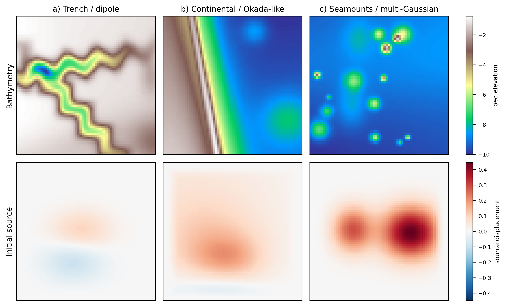
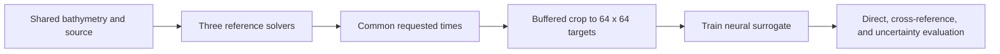

<div align="center">

# Reference-Aware Tsunami Surrogates

**A controlled multi-reference benchmark for neural PDE surrogates**

[About](#about) | [Results](#results) | [Paper and Data](#paper-and-data) | [Installation](#installation) | [Quick Start](#quick-start)


[](LICENSE)
[](paper/LICENSE)

</div>

## About

Neural surrogates inherit the numerical choices of the solver used to create their labels. This project makes that dependency measurable by advancing the same synthetic bathymetry and source scenarios with three reference models:

- Hydrostatic shallow-water equations;
- MUSCL-HR shallow-water equations; and
- a study-defined linear weakly dispersive Boussinesq-type reference.

Each reference keeps its natural time steps, then its outputs are interpolated to the same 50 requested times from `8.4` to `420.0` benchmark-time units. The shared construction is explicit:

```text
384 x 384 master fields -> 128 x 128 solver inputs
                       -> 192 x 192 buffered computation
                       -> central 64 x 64 published target
```

The main split contains 10,000 training, 1,000 validation, and 2,500 held-out test scenarios. The code, configs, manifests, and evaluation wrappers are designed to keep solver identity, requested-time alignment, normalization, and target resolution visible throughout the pipeline.

<p align="center">
  
</p>

### Workflow



Reference solutions are numerical label generators for this benchmark. They are not interchangeable physical truth, and the benchmark does not establish operational tsunami forecasting or event-scale hazard validity.

### Experiment status for the current manuscript

Updated 25 November 2026. The native-resolution, GEBCO-derived bathymetry, and additional thirty-case reference-sensitivity experiments are completed studies. Their scope and reproduction requirements are summarized below:

| Study | Completed evidence and scope |
|:--|:--|
| Native MUSCL-HR resolution transfer | Three separately trained FNOs evaluated on all three native grids, giving nine comparisons on 150 matched test scenarios. See [Native resolution transfer](#native-resolution-transfer) for the matrix and evaluation command. This study is not deferred. |
| GEBCO-derived bathymetry | Archived direct and conditional-window evaluations include ten fully wet morphology crops with synthetic forcing. The four public generation configurations now match the saved run settings; their schedules and output identities were checked against all 13 archived trajectories, including the separate illustrative and stress cases. This is morphology transfer, not real-event validation. |
| Full-horizon numerical sensitivity | Completed 92-rollout study of grid, time-step, boundary, lake-at-rest, and moving-equilibrium behavior. The six nested-grid cases show decreasing adjacent-grid differences for both SWE solvers; these are not formal convergence orders. |
| Fixed-prediction reference sensitivity | Completed 90-rollout Hydrostatic extension on 30 additional family-balanced scenarios, four models, and three seeds. Refining the reference core from 128 to 256 raises observed aggregate mean relative `L2` by 2.82–6.60% and swaps F-FNO/U-FNO ordering, with predictions unchanged. The original six-case result remains separate. |
| Matched GeoClaw comparison | Completed 24 comparisons across two in-house and two GeoClaw grids. In-house refinement improves Hydrostatic agreement in all three cases; MUSCL-HR improves in two cases but worsens by 17.34% for the rough-trench case at the finer GeoClaw grid. |
| Whole-trajectory uncertainty | Completed evaluation on 1,000 validation and 2,500 test scenarios. At nominal 90%, test coverage is 88.72% overall and 67.80% in the high-strength subgroup. This differs from the pointwise coverage reported below. |

The native-resolution and GEBCO evaluations are recorded in `evaluation_runs/final-v2-full-nonspeed-20260912-r6/`. The later numerical and whole-trajectory analyses have separate result files; their scripts and replay instructions are described under [Checkpoint and numerical evidence bundles](#checkpoint-and-numerical-evidence-bundles). A portable summary of the thirty-case scores and selected scenarios is included in [reference_sensitivity_30.json](paper/data/reference_sensitivity_30.json). Generated trajectory checkpoints, model weights, and full local evidence archives are not all included in a source-only clone. The public data archives and checkpoint availability are described under [Paper and Data](#paper-and-data).

## Results

The headline values below are the manuscript's reported held-out evidence. They should be read together with the scope and provenance notes in [Reproducibility and scope](#reproducibility-and-scope).

### Solver discrepancy

| Reference pair | Global solver-gap RMSE |
|:--|--:|
| Hydrostatic vs MUSCL-HR | `0.00171` |
| MUSCL-HR vs Boussinesq | `0.00305` |
| Hydrostatic vs Boussinesq | `0.00374` |

<p align="center">
  
</p>

### Changing the evaluation reference

On 30 additional scenarios, one per bathymetry–source combination, each of four models at three training seeds produces a fixed prediction. Only the Hydrostatic reference changes. The 90 new rollouts cover solver cores of 64, 128, and 256 cells, with all fields compared on the same 64-by-64 output grid.

| Model | Mean relative `L2`, core 128 | Mean relative `L2`, core 256 | Change in mean |
|:--|--:|--:|--:|
| ConvLSTM | 0.2078 | 0.2137 | +2.82% |
| F-FNO | 0.2446 | 0.2607 | +6.60% |
| U-FNO | 0.2486 | 0.2577 | +3.68% |
| FNO | 0.2640 | 0.2758 | +4.48% |

Values average per-scenario denormalized relative `L2` over seeds and equally weighted scenarios. Percentages are changes in the aggregate means, calculated before rounding. F-FNO and U-FNO exchange aggregate positions, and at least one model-pair ordering reverses in 7 of 30 scenarios after averaging seeds within each scenario. Adjacent-grid differences contract in all 30 cases.

This exploratory, family-balanced extension excludes the original six cases. It is not a population-weighted ranking or a new untouched test set. The observed mean increases are positive, but descriptive scenario-bootstrap intervals include zero for ConvLSTM and U-FNO; the ordering change does not establish architectural superiority. The original six-case study separately found increases of 2.04–5.08% with stable aggregate ordering.

### Pooled reference ablation

| Target reference | Solver-anonymous FNO | Solver-conditioned FNO |
|:--|--:|--:|
| Hydrostatic | `0.00258` | `0.00212` |
| MUSCL-HR | `0.00274` | `0.00252` |
| Boussinesq | `0.00357` | `0.00289` |

Conditioning on solver identity improves reference-specific agreement in this comparison. It does not remove the underlying discrepancy or establish which reference is physically correct.

### Direct models and uncertainty

Among nine Hydrostatic direct models, the lowest global relative `L2` values are:

| Model | Relative `L2` |
|:--|--:|
| ConvLSTM | `0.203` |
| U-FNO | `0.224` |
| F-FNO | `0.230` |

The headline table uses selected seed-18 checkpoints. A separate three-seed evaluation of the four leading Hydrostatic models (`18`, `36`, and `67`) preserves the same rank under mean per-scenario relative `L2`: ConvLSTM `0.2049 ± 0.0026`, U-FNO `0.2403 ± 0.0041`, F-FNO `0.2489 ± 0.0014`, and FNO `0.2673 ± 0.0053` (mean ± sample standard deviation across seeds). These values use a different aggregation from the global field values above; see `scripts/run_multiseed_evaluation.sh` for the evaluation procedure.

All six tested cross-reference discrepancy ratios exceed one, ranging from `1.10` to `1.72`. A seven-member FNO ensemble has `90%` marginal coverage of `0.682` before validation scaling and `0.910` after scaling; the reported high-strength subgroup reaches `0.796`.

Marginal coverage counts individual space–time values. A stricter analysis asks whether a band covers an entire trajectory: after validation scaling, nominal 90% whole-trajectory coverage is `0.8872` overall and `0.6780` in the high-strength subgroup. These empirical results do not establish an independent conformal coverage guarantee, because validation data also informed checkpoint selection.

<p align="center">
  
</p>

<p align="center">
  
</p>

<p align="center">
  
</p>

<p align="center">
  
</p>

## Models and evaluation lanes

The repository contains direct surrogate baselines and reference-aware lanes for the common-time benchmark:

- FNO, F-FNO, U-FNO, WNO, U-Net, CNN, and ConvLSTM baselines;
- direct same-reference accuracy on the frozen test split;
- pooled-reference anonymous and solver-conditioned comparisons;
- cross-reference discrepancy ratios and solver-gap diagnostics;
- resolution transfer, strict family holdouts, and real-bathymetry diagnostics;
- ensemble calibration, uncertainty correlation, and coverage analysis.

The evaluation wrapper is fail-closed. It records the data settings, code version, file inventories, checkpoints, and output details under `evaluation_runs/`.

## Paper and Data

**Manuscript.** *Reference-Aware Evaluation of Neural Surrogates for Shallow-Water Flows: A Controlled Multi-Reference Computational-Fluid Benchmark.* The paper source is in the [paper directory](paper/), with both journal and arXiv wrapper directories. See the [arXiv wrapper build instructions](paper/arxiv/README.md); article highlights are supplied separately in [highlights.txt](paper/highlights.txt).

**Repository.** [github.com/1zuki/tsunami-surrogate](https://github.com/1zuki/tsunami-surrogate)

**Data availability.** The public repository contains the source code, configuration files, data-generation and evaluation scripts, plotting scripts, and provenance helpers. The processed common-time benchmark data are publicly available from [Zenodo](https://doi.org/10.5281/zenodo.22997509); the raw numerical-reference data are available from [Zenodo](https://doi.org/10.5281/zenodo.22997523). Each record includes a release manifest and SHA-256 files for verifying the archive parts and reconstructed archives. The Zenodo records do not include the selected model checkpoints used for the reported evaluations; these are available from the corresponding author upon reasonable request. The real-bathymetry diagnostic uses the third-party GEBCO\_2026 Grid cited in the manuscript.

### Citation

If this repository or benchmark is useful, cite the associated work:

```bibtex
@unpublished{nguyen2026referenceaware,
  author = {Nguyen, Tho Binh An and Le, Minh Nhut Tan and Mai, Tien-Dung},
  title = {Reference-Aware Evaluation of Neural Surrogates for Shallow-Water Flows: A Controlled Multi-Reference Computational-Fluid Benchmark},
  year = {2026},
  note = {Manuscript in submission},
  url = {https://github.com/1zuki/tsunami-surrogate}
}
```

## Installation

The reference environment uses Python 3.10 or newer and PyTorch 2.10.

```bash
git clone https://github.com/1zuki/tsunami-surrogate.git
cd tsunami-surrogate

python -m venv .venv
source .venv/bin/activate
python -m pip install --upgrade pip
python -m pip install -r requirements.txt
```

For a CUDA installation, install the PyTorch wheel matching the local driver before installing the remaining pinned dependencies when the default wheel is not suitable for the machine.

Run the commands below from the repository root. Dataset, checkpoint, and output paths are relative to that directory. Paths under `defaults:` are relative to the configuration file that contains them. See the [configuration guide](docs/CONFIGURATION.md) for the supported settings and the [repository guide](docs/REPOSITORY_GUIDE.md) for optional studies and archived evidence.

## Quick Start

### 1. Run a small end-to-end check

This generates 2 training, 1 validation, and 1 test scenario for all three references, preprocesses each split, and trains and evaluates three small FNOs for one epoch. It keeps the 64-cell targets and 50 shared output times, with a shorter 8.4-unit horizon. Outputs stay under `data/smoke/`; they are pipeline checks, not paper results:

```bash
python scripts/run_smoke_pipeline.py
python scripts/run_smoke_pipeline.py --verify-only
```

Use a fresh subdirectory with `--output-root data/smoke/another-run` for another run. Sample counts, horizon, epochs, workers, and device can be changed with the flags shown by `--help`. Each run verifies publication hashes after resuming generation, unchanged training normalization, checkpoint data identities, repeatable evaluation, and rejection of a corrupted shard copy.

### 2. Obtain or generate the benchmark data

The processed common-time dataset is available from [Zenodo](https://doi.org/10.5281/zenodo.22997509), and the raw numerical-reference data are available from [Zenodo](https://doi.org/10.5281/zenodo.22997523). The records provide archive parts, release manifests, and checksums. They do not include the model checkpoints used for the reported evaluations; request selected checkpoints from the corresponding author if you need to replay those results. If you already have a local benchmark archive, verify every archive before use. The commands below assume a Unix-like shell with GNU coreutils and `zstd` installed:

```bash
sha256sum -c SHA256SUMS.txt
zstd -t --quiet *.tar.zst
```

To regenerate the three raw splits from the checked-in configs, use the resumable generator and then preprocess in order:

```bash
python scripts/make_dataset.py --config configs/data/dataset.yaml --continue
python scripts/make_dataset.py --config configs/data/dataset_eval.yaml --continue
python scripts/make_dataset.py --config configs/data/dataset_test.yaml --continue

python src/data_gen/preprocess.py --config configs/data/preprocess_train.yaml
python src/data_gen/preprocess.py --config configs/data/preprocess_eval.yaml
python src/data_gen/preprocess.py --config configs/data/preprocess_test.yaml
```

Validation and test preprocessing reuse the training normalization statistics. Do not run those stages before training preprocessing has completed.

### 3. Train one direct model

With the processed Hydrostatic split available:

```bash
python scripts/train.py --config configs/model/fno.yaml
```

The default run writes checkpoints under `experiments/fno/seed_18/`, including `best.pt` and `checkpoints/last.pt`.

### 4. Evaluate a model on metadata slices

```bash
python scripts/eval_slices.py \
  --config configs/model/fno.yaml \
  --checkpoint experiments/fno/seed_18/best.pt \
  --dataset data/processed/hydrostatic/test \
  --group-by source_type \
  --device auto \
  --output evaluation_runs/local-source-slices.json
```

### 5. Run the fail-closed evaluation wrapper

Read-only preflight:

```bash
bash scripts/run_eval_suite.sh --no-real-bathymetry
```

The complete paper-evidence lane is intentionally explicit and can require large datasets, frozen checkpoints, and external GeoClaw/PETSc dependencies:

```bash
bash scripts/run_eval_suite.sh \
  --execute \
  --run-id paper-evaluation-local \
  --include-paper-evidence \
  --device cuda
```

## Checks and cluster use

A source-only clone contains no datasets or selected model weights. Start with the source checks and the read-only evaluation preflight; full evaluation requires the data and checkpoints listed by that preflight.

```bash
python -m pip install pytest
python -m pytest -q -m "not slow"
bash scripts/run_eval_suite.sh --include-ensemble --device cpu
```

For Slurm, create `logs/slurm` before submission. Jobs use the repository's `.venv` by default; set `ENV_PREFIX` for another local environment. Submit from the repository root, or export `PROJECT_ROOT`. Resource profiles in the supplied scripts target the UIT cluster and must be adapted for another cluster. The training-suite manifest records its account, partition, GPU profile, CPU, memory, time, and concurrency settings. Other running jobs can reduce the available concurrency.

```bash
mkdir -p logs/slurm
python scripts/prepare_cluster_training_suite.py --help
```

CPU-only jobs depend on the site's scheduling policy; check administrator guidance before submitting them. The scripts leave GPU visibility to Slurm.

## Additional evaluations

The main paper evaluation uses `configs/eval/benchmark_suite.yaml`. Separate tools cover the three-seed model analysis, pooled-reference comparisons, numerical checks, and whole-trajectory uncertainty:

```bash
bash scripts/run_multiseed_evaluation.sh --preflight-only
python scripts/eval_pooled_reference_ablation.py --help
python scripts/run_benchmark_numerical_study.py --help
python scripts/run_reference_sensitivity_30.py --help
python scripts/eval_trajectory_calibration.py --help
```

The wrapper stages a new evaluation under `evaluation_runs/<run-id>.staging/` and promotes it only after the required outputs pass validation. Add `--include-speed` for timing measurements. Expensive numerical reruns are separate and require GeoClaw/PETSc where specified; set `CLAW_ROOT` and `PETSC_DIR` for your installation. The default tool locations are `.tools/clawpack-v5.14.0` and `.tools/petsc-3.25.3` beneath the repository.

To regenerate figures from an existing validated evaluation:

```bash
python scripts/plot_reference_diagnostics.py --evaluation-run evaluation_runs/<run-id>
python scripts/plot_sample_scaling.py --evaluation-run evaluation_runs/<run-id>
```

## Native resolution transfer

Prerequisites:
- generate native-grid forward data per resolution
- preprocess each resolution
- use the completed MUSCL-HR checkpoints from the final paper roster for
  cross-resolution evaluation

This completed auxiliary experiment is separate from the core $64 \times 64$ campaign. The checked-in `configs/data/multires/dataset_{32,64,128}.yaml` files specify the shared output times and grid construction: 50 requested times from 8.4 to 420, horizontal and temporal scales of 2400, vertical scale of 1, and paired inputs reduced from a shared 384-cell master to solver and target grids of 32, 64, or 128 cells. Each grid has 700/150/150 train/validation/test scenarios. The archived result is `evaluation_runs/final-v2-full-nonspeed-20260912-r6/paper_evidence/resolution/native_muscl_hr.json`; it identifies the three checkpoints and all nine training-grid/test-grid comparisons. The matrix values in the manuscript come from that run, not from the earlier `final-v2-paper-full-r2` archive.

Each entry below is denormalized benchmark-scale relative `L2` on 150 matched test scenarios:

| Training grid | Test 32 | Test 64 | Test 128 |
|:--|--:|--:|--:|
| 32 | **0.353** | 0.670 | 0.808 |
| 64 | 0.473 | **0.387** | 0.530 |
| 128 | 0.591 | 0.433 | **0.412** |

For each model, evaluation inputs are converted to that model's training normalization, and predictions and targets are compared after denormalization. Shared physical scaling does not mean that independently fitted normalization statistics are assumed equal. Each native model uses 700 training scenarios, so comparison with the main 10,000-scenario Hydrostatic model cannot isolate the effect of resolution.

To regenerate the native-resolution data, use the current configs and matching preprocessing configs:

```bash
python scripts/make_dataset.py --config configs/data/multires/dataset_32.yaml
python scripts/make_dataset.py --config configs/data/multires/dataset_64.yaml
python scripts/make_dataset.py --config configs/data/multires/dataset_128.yaml
```

Run a small isolated canary and verify its timestamps, quality status, crop, paired-input provenance, and peak memory before generating a full resolution split. Keep this auxiliary generation separate from the core data roots.

Preprocess each generated dataset with its matching configuration:

```bash
python src/data_gen/preprocess.py --config configs/data/multires/preprocess_32.yaml
python src/data_gen/preprocess.py --config configs/data/multires/preprocess_64.yaml
python src/data_gen/preprocess.py --config configs/data/multires/preprocess_128.yaml
```

Evaluate the completed MUSCL-HR checkpoints across all real resolutions in one JSON table:

```bash
python scripts/eval_native_transfer.py \
  --contract configs/eval/benchmark_suite.yaml \
  --device cpu \
  --output native-resolution-results.json
```

Output file:
- `native-resolution-results.json`, containing all nine comparisons and the normalization settings used for each model. This requires the three native-resolution checkpoints and the three processed test datasets listed in `configs/eval/benchmark_suite.yaml`.

For separate single-checkpoint experiments, `eval_full_resolution.py` uses a stricter normalization policy:
- `configs/eval/resolution_*.yaml` now defaults to `real_resolution.normalization_policy: require_target_stats_match`.
- This fails fast if suite target normalization does not match the configured training/reference dataset stats (`normalization_reference_path`), which avoids misleading cross-resolution claims.

Optional shared-normalization cross-resolution transfer from the res64 reference:

```bash
python src/data_gen/preprocess.py --config configs/data/multires/preprocess_32_shared_from64.yaml
python src/data_gen/preprocess.py --config configs/data/multires/preprocess_64_shared_from64.yaml
python src/data_gen/preprocess.py --config configs/data/multires/preprocess_128_shared_from64.yaml

python scripts/train.py --config configs/model/fno_res64_shared_from64_hydrostatic.yaml
python scripts/train.py --config configs/model/fno_res64_shared_from64_muscl_hr.yaml

python scripts/eval_full_resolution.py \
  --config configs/eval/resolution_hydrostatic_shared_from64.yaml \
  --checkpoint experiments/fno_res64_shared_from64_hydrostatic/best.pt
python scripts/eval_full_resolution.py \
  --config configs/eval/resolution_muscl_hr_shared_from64.yaml \
  --checkpoint experiments/fno_res64_shared_from64_muscl_hr/best.pt
```

Important:
- `eval_full_resolution.py` now validates that checkpoint training normalization stats match the configured reference stats.  
- For the final paper claim, use the native MUSCL-HR roster. Do not present the exploratory Hydrostatic/shared-from64 paths as part of that result.
- The reported native matrix uses the dedicated `fno_res{32,64,128}_muscl_hr` checkpoints. The optional shared-from64 experiments require their own shared-from64 checkpoints; generic core-model checkpoints cannot substitute for either set.

## Repository Layout

```text
configs/
  data/                 Dataset generation and preprocessing settings
  model/                Direct surrogate model configurations
  eval/                 Common-time and auxiliary evaluation settings
src/
  data_gen/             Scenario generation and preprocessing
  models/               FNO and baseline architectures
  solver/               Reference solver implementations
  evaluation/           Metrics, calibration, and diagnostics
scripts/                Training, evaluation, plotting, and release tools
paper/                  Manuscript source, figures, tables, and wrappers
tests/                  Consistency and regression tests
data/, experiments/,
evaluation_runs/        Generated datasets, checkpoints, and evidence bundles
```

## Reproducibility and scope

- Keep raw data, processed data, checkpoints, and evaluation outputs together with their file inventories and generation settings.
- Treat the reported manuscript values as evidence from their recorded evaluation runs, not as a replacement for a fresh check of the data-generation and evaluation settings.
- Preserve the distinction between solver agreement, numerical verification, and physical validation.
- This is a synthetic, finite-horizon research benchmark. It is not an operational tsunami-warning system, a hazard map, or event-scale validation.

## License

**Code:** The source code is released under the [MIT License](LICENSE).

**Paper:** The manuscript text and original figures in the paper directory are
licensed under [CC BY-NC-ND 4.0](paper/LICENSE). Third-party material is
excluded from this license and remains subject to its own terms.

## Acknowledgements

We acknowledge the University of Information Technology, Vietnam National University Ho Chi Minh City, for academic and facility support; and the GEBCO Bathymetric Compilation Group and NERC EDS British Oceanographic Data Centre for the GEBCO-derived real-bathymetry diagnostic data.

## Checkpoint and numerical evidence bundles

A local checkpoint bundle can be prepared from the archived evaluation run and original training outputs. From the repository root, use the project Python environment to preview the contents and build a new archive:

```bash
python scripts/build_core_checkpoint_release.py --plan
python scripts/build_core_checkpoint_release.py --plan --trajectory-evidence /path/to/verified-trajectory-results
python scripts/build_core_checkpoint_release.py --build artifacts/tsunami-core-checkpoints.tar --trajectory-evidence /path/to/verified-trajectory-results
```

The build prints the archive SHA-256. The bundle contains inference weights, resolved training configurations, normalization statistics, archived metrics, and a manifest that maps the replay commands to manuscript tables. The trajectory-results directory must contain the full validation/test scores, physical-risk summary, lineage audit, and the exact source snapshots used to compute them; the builder checks their identities before packaging. The original checkpoint hashes and the archived evaluation code identity are recorded separately from the exported weights and bundled source.

To include the twelve completed-training records needed for the reference-resolution comparison, add `--reference-resolution-preflight /path/to/reference_resolution_checkpoint_preflight.json` when planning or building. The builder checks this record against the original checkpoints and includes it with the inference weights.

After verifying and extracting the bundle, restore the processed data from [Zenodo](https://doi.org/10.5281/zenodo.22997509) under `data/processed` and install the dependencies in `requirements.txt`. Run the following command from the extracted directory to verify the inputs and replay the direct accuracy, multi-seed, cross-reference, primary pooled-reference, ensemble, and whole-trajectory reliability metrics into a new directory:

```bash
python scripts/build_core_checkpoint_release.py --replay replay-results --device cuda
python scripts/plot_trajectory_reliability.py --input replay-results/trajectory/trajectory_calibration_physical.json --output trajectory-reliability.pdf
```

The separate numerical evidence archive contains the completed 92-run study. With that archive extracted and the checkpoint bundle built with the completed-training records, score fixed predictions against the four Hydrostatic reference fields from the checkpoint directory:

```bash
python scripts/eval_reference_resolution_sensitivity.py --release-root . --study /path/to/revision-evidence/benchmark_numerical --device cuda --batch-size 2 --output reference-resolution-results.json
```

This command replays the original six-case comparison using the same predictions at every reference resolution; it does not retrain the models or test native neural-network resolution transfer. The checkpoint bundle contains inference weights rather than the optimizer state needed to resume training.

The additional thirty-case study is separate from that archive. Its completed result is `reference_resolution_sensitivity_30.json`, accompanied by 90 numerical trajectory checkpoints, twelve saved prediction sets, and their input and model identities. The portable [manuscript evidence file](paper/data/reference_sensitivity_30.json) contains the selected scenarios, per-seed scores, aggregate table values, and ordering changes. It does not contain the full reference trajectories or model weights, and the earlier checkpoint/numerical archives have not been repackaged to include this extension. Selection and execution use `configs/eval/reference_sensitivity_30.yaml`, `scripts/plan_reference_sensitivity.py`, and `scripts/run_reference_sensitivity_30.py`; `scripts/resume_reference_sensitivity_30.py` reuses verified checkpoints and predictions after an interruption. Reproduction requires the original data and selected model weights, not just this score summary.

The numerical evidence archive also includes 24 matched comparisons between newly computed in-house trajectories and both GeoClaw grids, together with the six input files needed to verify their initial states. From its extracted directory, regenerate these comparisons without running either solver:

```bash
python scripts/summarize_matched_geoclaw_comparison.py \
  --study benchmark_numerical --geoclaw-summary geoclaw_resolution_summary_final.json \
  --coarse-bundle geoclaw_frozen_192 --coarse-external geoclaw_external \
  --fine-bundle geoclaw_frozen_384 --fine-external geoclaw_refined_external \
  --input-root matched_geoclaw_inputs --output matched-comparison-rerun.json
```

The benchmark data record and checkpoint bundle are distributed separately. Public publication of the checkpoint bundle is pending.

The numerical archive and locally built manuscript PDFs are also separate from the published benchmark datasets. An earlier evidence archive may contain an earlier manuscript revision; use the current `paper/` sources when reviewing the current paper. The full 120-scenario reproduction rerun was not completed and is not used to support the results above.
