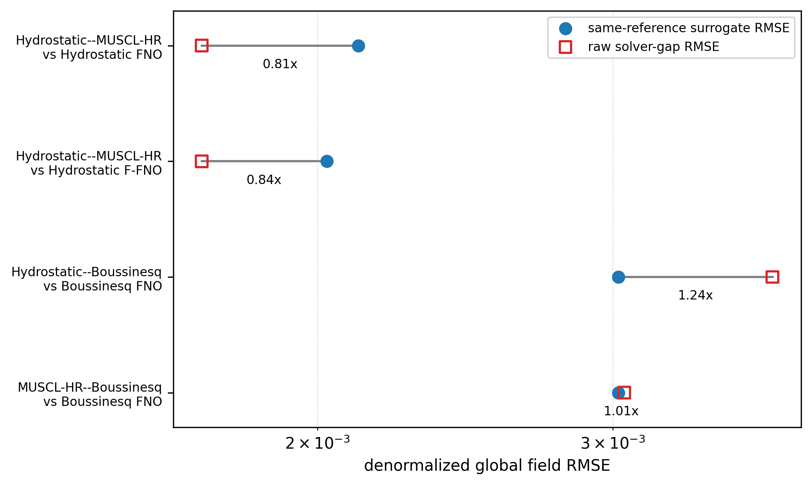
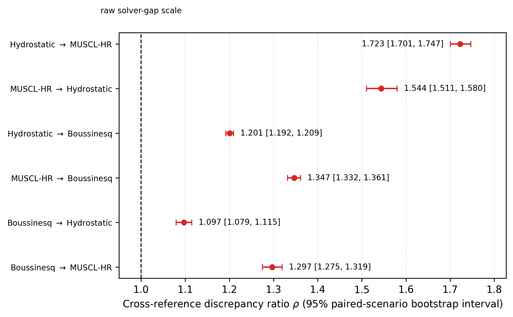
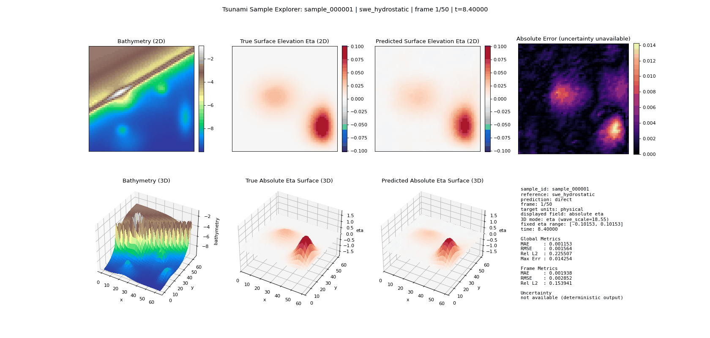
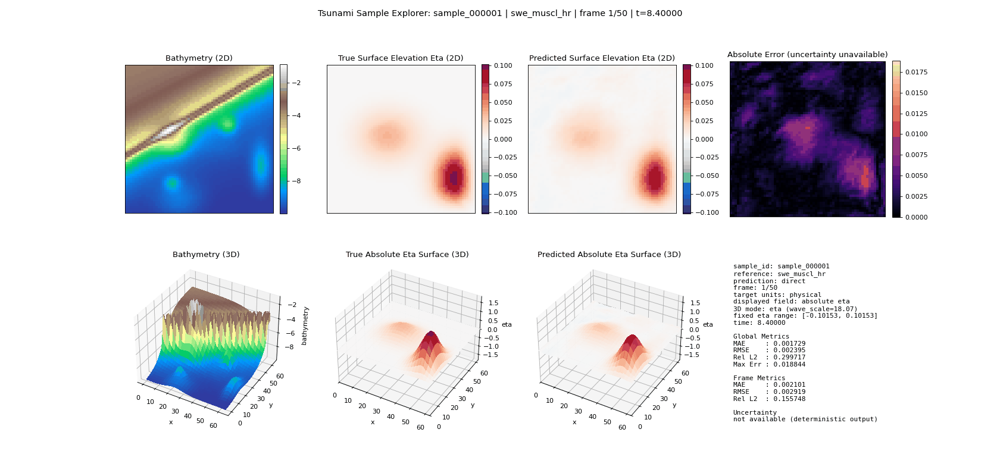
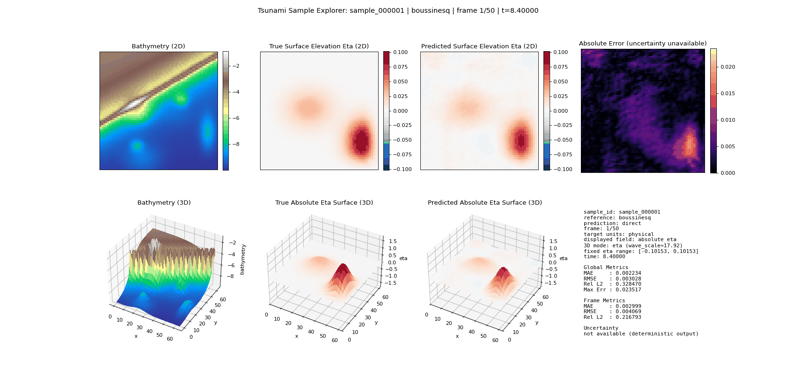

<div align="center">

# Reference-Aware Tsunami Surrogates

**A controlled multi-reference benchmark for neural PDE surrogates**

[About](#about) | [Results](#results) | [Paper and Data](#paper-and-data) | [Installation](#installation) | [Quick Start](#quick-start)


[](LICENSE)
[](paper/LICENSE)

</div>

## About

Neural surrogates inherit the numerical choices of the solver used to create their labels. This project makes that dependency measurable by advancing the same synthetic bathymetry and source scenarios with three reference models:

- Hydrostatic shallow-water equations;
- MUSCL-HR shallow-water equations; and
- a study-defined linear weakly dispersive Boussinesq-type reference.

Each reference keeps its natural time steps, then its outputs are interpolated to the same 50 requested times from `8.4` to `420.0` benchmark-time units. The shared construction is explicit:

```text
384 x 384 master fields -> 128 x 128 solver inputs
                       -> 192 x 192 buffered computation
                       -> central 64 x 64 published target
```

The main split contains 10,000 training, 1,000 validation, and 2,500 held-out test scenarios. The code, configs, manifests, and evaluation wrappers are designed to keep solver identity, requested-time alignment, normalization, and target resolution visible throughout the pipeline.

<p align="center">
  
</p>

### Workflow


Reference solutions are numerical label generators for this benchmark. They are not interchangeable physical truth, and the benchmark does not establish operational tsunami forecasting or event-scale hazard validity.

### Experiment status for the current manuscript

Updated 25 November 2026. The native-resolution experiment and the GEBCO-derived bathymetry evaluation are completed studies. Their status should be distinguished from the readiness of individual regeneration templates:

| Study | Completed evidence and scope |
|:--|:--|
| Native MUSCL-HR resolution transfer | Three separately trained FNOs evaluated on all three native grids, giving nine comparisons on 150 matched test scenarios. See [Section 6.8](#68-native-real-resolution-benchmark-3264128) for the matrix and evaluation command. This study is not deferred. |
| GEBCO-derived bathymetry | Archived direct and conditional-window evaluations include ten fully wet morphology crops with synthetic forcing. Some checked-in generation templates remain outdated; use the saved generation settings described below. This is morphology transfer, not real-event validation. |
| Full-horizon numerical sensitivity | Completed 92-rollout study of grid, time-step, boundary, lake-at-rest, and moving-equilibrium behavior. The six nested-grid cases show decreasing adjacent-grid differences for both SWE solvers; these are not formal convergence orders. |
| Fixed-prediction reference sensitivity | Completed comparison of four models and three seeds on six cases. Refining the Hydrostatic reference core from 128 to 256 raises mean per-scenario relative `L2` by 2.04–5.08%, with predictions held unchanged. This is separate from native neural-network resolution transfer. |
| Matched GeoClaw comparison | Completed 24 comparisons across two in-house and two GeoClaw grids. In-house refinement improves Hydrostatic agreement in all three cases; MUSCL-HR improves in two cases but worsens by 17.34% for the rough-trench case at the finer GeoClaw grid. |
| Whole-trajectory uncertainty | Completed evaluation on 1,000 validation and 2,500 test scenarios. At nominal 90%, test coverage is 88.72% overall and 67.80% in the high-strength subgroup. This differs from the pointwise coverage reported below. |

The native-resolution and GEBCO evaluations are recorded in `evaluation_runs/final-v2-full-nonspeed-20260912-r6/`. The later numerical and whole-trajectory analyses have separate result files; their scripts and replay instructions are described under [Checkpoint and numerical evidence bundles](#checkpoint-and-numerical-evidence-bundles). Generated evaluation records, checkpoints, and local evidence archives are not all included in a source-only clone. The public data archives and checkpoint availability are described under [Paper and Data](#paper-and-data).

## Results

The headline values below are the manuscript's reported held-out evidence. They should be read together with the scope and provenance notes in [Reproducibility and scope](#reproducibility-and-scope).

### Solver discrepancy

| Reference pair | Global solver-gap RMSE |
|:--|--:|
| Hydrostatic vs MUSCL-HR | `0.00171` |
| MUSCL-HR vs Boussinesq | `0.00305` |
| Hydrostatic vs Boussinesq | `0.00374` |

<p align="center">
  
</p>

### Pooled reference ablation

| Target reference | Solver-anonymous FNO | Solver-conditioned FNO |
|:--|--:|--:|
| Hydrostatic | `0.00258` | `0.00212` |
| MUSCL-HR | `0.00274` | `0.00252` |
| Boussinesq | `0.00357` | `0.00289` |

Conditioning on solver identity improves reference-specific agreement in this comparison. It does not remove the underlying discrepancy or establish which reference is physically correct.

### Direct models and uncertainty

Among nine Hydrostatic direct models, the lowest global relative `L2` values are:

| Model | Relative `L2` |
|:--|--:|
| ConvLSTM | `0.203` |
| U-FNO | `0.224` |
| F-FNO | `0.230` |

The headline table uses selected seed-18 checkpoints. A separate three-seed evaluation of the four leading Hydrostatic models (`18`, `36`, and `67`) preserves the same rank under mean per-scenario relative `L2`: ConvLSTM `0.2049 ± 0.0026`, U-FNO `0.2403 ± 0.0041`, F-FNO `0.2489 ± 0.0014`, and FNO `0.2673 ± 0.0053` (mean ± sample standard deviation across seeds). These values use a different aggregation from the global field values above; see `scripts/run_multiseed_evaluation.sh` for the evaluation procedure.

All six tested cross-reference discrepancy ratios exceed one, ranging from `1.10` to `1.72`. A seven-member FNO ensemble has `90%` marginal coverage of `0.682` before validation scaling and `0.910` after scaling; the reported high-strength subgroup reaches `0.796`.

Marginal coverage counts individual space–time values. A stricter analysis asks whether a band covers an entire trajectory: after validation scaling, nominal 90% whole-trajectory coverage is `0.8872` overall and `0.6780` in the high-strength subgroup. These empirical results do not establish an independent conformal coverage guarantee, because validation data also informed checkpoint selection.

<p align="center">
  
</p>

<p align="center">
  
</p>

<p align="center">
  
</p>

<p align="center">
  
</p>

## Models and evaluation lanes

The repository contains direct surrogate baselines and reference-aware lanes for the common-time benchmark:

- FNO, F-FNO, U-FNO, WNO, U-Net, CNN, and ConvLSTM baselines;
- direct same-reference accuracy on the frozen test split;
- pooled-reference anonymous and solver-conditioned comparisons;
- cross-reference discrepancy ratios and solver-gap diagnostics;
- resolution transfer, strict family holdouts, and real-bathymetry diagnostics;
- ensemble calibration, uncertainty correlation, and coverage analysis.

The evaluation wrapper is fail-closed. It records the data settings, code version, file inventories, checkpoints, and output details under `evaluation_runs/`.

## Paper and Data

**Manuscript.** *Reference-Aware Evaluation of Neural Surrogates for Shallow-Water Flows: A Controlled Multi-Reference Computational-Fluid Benchmark.* The paper source is in the [paper directory](paper/), with both journal and arXiv wrapper directories. See the [arXiv wrapper build instructions](paper/arxiv/README.md); article highlights are supplied separately in [highlights.txt](paper/highlights.txt).

**Repository.** [github.com/1zuki/tsunami-surrogate](https://github.com/1zuki/tsunami-surrogate)

**Data availability.** The public repository contains the source code, configuration files, data-generation and evaluation scripts, plotting scripts, and provenance helpers. The processed common-time benchmark data are publicly available from [Zenodo](https://doi.org/10.5281/zenodo.22997509); the raw numerical-reference data are available from [Zenodo](https://doi.org/10.5281/zenodo.22997523). Each record includes a release manifest and SHA-256 files for verifying the archive parts and reconstructed archives. The Zenodo records do not include the selected model checkpoints used for the reported evaluations; these are available from the corresponding author upon reasonable request. This README and the current manuscript do not cite the superseded benchmark DOI or the earlier mutable file mirror. The real-bathymetry diagnostic uses the third-party GEBCO\_2026 Grid cited in the manuscript.

### Citation

If this repository or benchmark is useful, cite the associated work:

```bibtex
@unpublished{nguyen2026referenceaware,
  author = {Nguyen, Tho Binh An and Le, Minh Nhut Tan and Mai, Tien-Dung},
  title = {Reference-Aware Evaluation of Neural Surrogates for Shallow-Water Flows: A Controlled Multi-Reference Computational-Fluid Benchmark},
  year = {2026},
  note = {Manuscript in submission},
  url = {https://github.com/1zuki/tsunami-surrogate}
}
```

## Installation

The reference environment uses Python 3.10 or newer and PyTorch 2.10.

```bash
git clone https://github.com/1zuki/tsunami-surrogate.git
cd tsunami-surrogate

python -m venv .venv
source .venv/bin/activate
python -m pip install --upgrade pip
python -m pip install -r requirements.txt
```

For a CUDA installation, install the PyTorch wheel matching the local driver before installing the remaining pinned dependencies when the default wheel is not suitable for the machine.

## Quick Start

### 1. Run the one-sample smoke path

This exercises the dataset-generation entry point without starting a full 10,000-scenario campaign:

```bash
bash scripts/quickstart.sh
```

### 2. Obtain or generate the benchmark data

The processed common-time dataset is available from [Zenodo](https://doi.org/10.5281/zenodo.22997509), and the raw numerical-reference data are available from [Zenodo](https://doi.org/10.5281/zenodo.22997523). The records provide archive parts, release manifests, and checksums. They do not include the model checkpoints used for the reported evaluations; request selected checkpoints from the corresponding author if you need to replay those results. If you already have a local benchmark archive, verify every archive before use. The commands below assume a Unix-like shell with GNU coreutils and `zstd` installed:

```bash
sha256sum -c SHA256SUMS.txt
zstd -t --quiet *.tar.zst
```

To regenerate the three raw splits from the checked-in configs, use the resumable generator and then preprocess in order:

```bash
python scripts/make_dataset.py --config configs/data/dataset.yaml --continue
python scripts/make_dataset.py --config configs/data/dataset_eval.yaml --continue
python scripts/make_dataset.py --config configs/data/dataset_test.yaml --continue

python src/data_gen/preprocess.py --config configs/data/preprocess_train.yaml
python src/data_gen/preprocess.py --config configs/data/preprocess_eval.yaml
python src/data_gen/preprocess.py --config configs/data/preprocess_test.yaml
```

Validation and test preprocessing reuse the training normalization statistics. Do not run those stages before training preprocessing has completed.

### 3. Train one direct model

With the processed Hydrostatic split available:

```bash
python scripts/train.py --config configs/model/fno.yaml
```

The default run writes checkpoints under `experiments/fno/seed_18/`, including `best.pt` and `checkpoints/last.pt`.

### 4. Evaluate a model on metadata slices

```bash
python scripts/eval_v2_slices.py \\
  --config configs/model/fno.yaml \\
  --checkpoint experiments/fno/seed_18/best.pt \\
  --dataset data/processed/hydrostatic/test \\
  --group-by source_type \\
  --device auto \\
  --output evaluation_runs/local-source-slices.json
```

### 5. Run the fail-closed evaluation wrapper

Read-only preflight:

```bash
bash scripts/run_eval_suite.sh --no-real-bathymetry
```

The complete paper-evidence lane is intentionally explicit and can require large datasets, frozen checkpoints, and external GeoClaw/PETSc dependencies:

```bash
bash scripts/run_eval_suite.sh \\
  --execute \\
  --run-id final-v2-paper-full-local \\
  --include-paper-evidence \\
  --device cuda
```

<details>
<summary>Advanced command archive</summary>

## 5b) Fresh-machine checks, generation, and result verification (recommended)

Cloning the GitHub repository does **not** download the ignored datasets, checkpoints, or evaluation archives. Do not start by running every historical command in Appendix A. You can either download the public benchmark data described in Section 5c or rebuild the solver data from scratch:

- **Archived-result inspection:** restore the processed data, checkpoints, and archived evidence described in Section 5b.2 only when inspecting the earlier campaign; do not mix those artifacts with a fresh rebuild.
- **From-scratch path:** generate the raw solver publications with the split-specific configs in Section 5b.5, then continue with the detailed generation, preprocessing, training, and evaluation commands in Appendix A.

The sections below cover source checks, current data status, evaluation, and from-scratch generation:

### 5b.1 Source check

This checks the installed dependencies, imports, Python compilation, and shell syntax. It does not regenerate solver data, retrain models, or establish scientific validity.

```bash
PYTHONPATH=. python -c "import numpy, torch, scipy, yaml; import src"
python -m compileall -q src scripts
bash -n scripts/*.sh
```

The broader non-slow pytest collection is optional. It can take substantially longer than this check and some tests exercise release-only scientific fixtures (for example, strict-holdout manifests):

For a fast contract-level check that works from a bare clone:

```bash
python -m pytest -q \
  tests/test_alignment.py \
  tests/test_model_io.py \
  tests/test_device_precision.py
```

```bash
# pytest is an optional test dependency and may need a separate install.
python -m pip install pytest
OPENBLAS_NUM_THREADS=1 \
OMP_NUM_THREADS=1 \
MKL_NUM_THREADS=1 \
NUMEXPR_NUM_THREADS=1 \
VECLIB_MAXIMUM_THREADS=1 \
BLIS_NUM_THREADS=1 \
PYTHONPATH=. \
python -m pytest -q -m 'not slow'
```

Run it after restoring the required benchmark artifacts when you want the broader implementation check. Passing it is still not a replacement for the data/evaluation and numerical-validation checks below.

### 5b.2 Data-status check

The processed common-time dataset and raw numerical-reference data are publicly available from [Zenodo](https://doi.org/10.5281/zenodo.22997509) and [Zenodo](https://doi.org/10.5281/zenodo.22997523). Both records provide release manifests and checksum files. The records do not include model checkpoints; request the selected checkpoints from the corresponding author for exact result replay, or regenerate them from the pinned configurations in Section 5b.5. Do not use the superseded benchmark DOI or the earlier mutable file mirror in a new reproduction record.

If you already have a locally obtained archived bundle from the earlier campaign, keep it outside the repository source directory and verify its checksums before extraction. Treat that bundle as historical evidence for the archived run, not as the current public data release. Do not mix its artifacts with a fresh rebuild.

For a small independent model/data check after the required local artifacts are available, run one metric directly and write its output outside the repository:

```bash
mkdir -p "$HOME/tsunami-source-check"
python scripts/eval_accuracy.py \
  --config configs/model/fno.yaml \
  --checkpoint experiments/fno/seed_18/best.pt \
  --device cpu \
  --output "$HOME/tsunami-source-check/fno_hydrostatic.json"
```

The full fail-closed `run_eval_suite.sh` additionally expects the complete project provenance used by the final run: frozen generation artifacts, training sidecars such as `checkpoints/last.pt`, and a clean evaluation source state. On a bare fresh clone, use the source check and direct metric check above to verify the public source; run the full wrapper only from a fully restored project directory that contains the required data and run records.

### 5b.3 Full evaluation

On a fully restored project directory, first run the read-only prerequisite preflight:

```bash
# CPU is portable; use --device cuda on a configured CUDA VM.
bash scripts/run_eval_suite.sh --include-ensemble --device cpu
```

If it passes, execute the suite once with a new immutable run ID. Results are staged under `evaluation_runs/<run-id>.staging/` and promoted only after consolidation validates the declared outputs:

```bash
bash scripts/run_eval_suite.sh \
  --execute \
  --run-id source-check-20260824-r1 \
  --device cpu \
  --include-paper-evidence
```

Use `--device cuda` on a configured GPU VM. Add `--include-speed` only when timing rows are intentionally being regenerated, and add `--deep-payload-audit` when a full payload re-hash is wanted. Do not reuse an existing run ID, and do not run the complete suite twice unless the first run fails or the environment changes. The paper-evidence option already includes the seven-member ensemble and every metric declared in the paper suite.

The separate three-seed direct-model and GeoClaw-discrepancy follow-up analyses are packaged and rerun separately; they are not silently folded into this wrapper. From a fully restored project directory, their commands are:

```bash
bash scripts/run_multiseed_evaluation.sh --preflight-only
bash scripts/run_multiseed_evaluation.sh
python scripts/run_geoclaw_discrepancy_ablation.py --workers 4
```

These commands write separate multiseed/GeoClaw outputs. If the archived outputs are sufficient for the review, inspect those instead of regenerating them.

### 5b.4 Optional fresh numerical-validation replay

The numerical-validation flag is a separate, much heavier H0/Level-A/Level-B/H1/H2 replay. It requires a clean committed `src/`/`scripts/`/`configs/` state, GeoClaw 5.14.0, PETSc, and the paths supplied through the environment:

```bash
export CLAW_ROOT=/path/to/clawpack-v5.14.0
export PETSC_DIR=/path/to/petsc-3.25.3
export PETSC_ARCH=arch-linux-c-opt
export GEOCLAW_PYTHON="$PWD/.venv/bin/python"

bash scripts/run_eval_suite.sh \
  --execute \
  --run-id source-check-20260824-numerical-r1 \
  --device cpu \
  --include-paper-evidence \
  --deep-payload-audit \
  --rerun-numerical-validation
```

If GeoClaw/PETSc are not installed, omit this flag and inspect the archived numerical evidence instead. Do not regenerate the approximately 31 GB raw publication set or retrain the ensemble merely to check out the source.

### 5b.5 Generate the raw benchmark from scratch

The repository supports rebuilding the synthetic solver data instead of downloading processed archives. The full core campaign creates 10,000 training, 1,000 validation, and 2,500 test scenarios for each of the three configured references (40,500 solver publications in total). This is a large CPU/storage workload; reserve at least 100 GB for the raw campaign and additional space for processed arrays, checkpoints, and evaluation outputs.

For this core launch, use only `configs/data/dataset.yaml`, `configs/data/dataset_eval.yaml`, and `configs/data/dataset_test.yaml`. The native-resolution configs under `configs/data/multires/` describe the separate, completed native-resolution experiment; they use 50 outputs from 8.4 to 420 and a shared 384-cell master input.

The completed GEBCO evaluations used saved generation settings under `data/real_bathymetry_v2/configs/`, including `main_morphology_suite_10_dataset.yaml`, together with the corresponding scenario and paired-input inventories under `data/real_bathymetry_v2/manifests/`. These saved settings use the 8.4-to-420 output schedule and horizontal/time scales of 2400. By contrast, the checked-in templates at `configs/data/real_bathymetry_v2/*_dataset.yaml` still specify the earlier 0.0035-to-0.175 schedule and are marked for preparation only. They are not suitable for reproducing the reported GEBCO results. This limitation concerns regeneration from those templates; it does not mean the archived evaluation is unfinished. The saved data and settings must be obtained separately if absent from a source-only clone.

From the repository root, after completing Section 5, run the split-specific
generation configs:

```bash
set -o pipefail
export OMP_NUM_THREADS=1 OPENBLAS_NUM_THREADS=1 MKL_NUM_THREADS=1
export NUMEXPR_NUM_THREADS=1 BLIS_NUM_THREADS=1 VECLIB_MAXIMUM_THREADS=1

# Train split: 10,000 scenarios.
python scripts/make_dataset.py --config configs/data/dataset.yaml 2>&1 | tee train-generation.log

# Validation/evaluation split: 1,000 scenarios.
python scripts/make_dataset.py --config configs/data/dataset_eval.yaml 2>&1 | tee validation-generation.log
```

These commands write raw publications and provenance manifests under `data/train/` and `data/eval/`. Add `--continue` to the same command after an interruption and use `tee -a` to append to the existing log; completed publications are validated and reused. Keep the seed-911 final test split unopened until the model matrix and analysis choices are frozen, then generate it with `python scripts/make_dataset.py --config configs/data/dataset_test.yaml 2>&1 | tee test-generation.log`.

Do not use a reduced `--num-samples` value against a canonical split root if that root will later be expanded to the full split: the paired-input inventory intentionally freezes the configured roster. Small canaries must use isolated output, bathymetry, source, manifest, and paired-inventory paths; the full production command should then start from the empty canonical root.

An isolated eight-worker canary can be run without touching the canonical roots:

```bash
CANARY_ROOT="$(mktemp -d /tmp/tsunami-surrogate-canary.XXXXXX)"
python scripts/make_dataset.py \
  --config configs/data/dataset.yaml \
  --num-samples 8 \
  --num-workers 8 \
  --stop-at 8 \
  --bathymetry-dir "$CANARY_ROOT/bathymetry" \
  --source-dir "$CANARY_ROOT/sources" \
  --output-dir "$CANARY_ROOT/raw" \
  --manifest-path "$CANARY_ROOT/synthetic/scenario_manifest.jsonl" \
  --paired-inventory-path "$CANARY_ROOT/synthetic/native_input_inventory.jsonl" \
  2>&1 | tee "$CANARY_ROOT/generation.log"
```

This canary root is disposable and must not be copied into `data/train/`. A successful run produces eight scenario rows, eight rows in each solver manifest, 24 quality-`ok` publications, and one complete output shard with matching generation settings.

After all three raw splits exist, preprocess them in this order:

```bash
# 1. Required first: fits normalization statistics from training data only.
python src/data_gen/preprocess.py --config configs/data/preprocess_train.yaml

# 2. Reuses the frozen training statistics and writes data/processed/*/val.
python src/data_gen/preprocess.py --config configs/data/preprocess_eval.yaml

# 3. Reuses the same statistics and writes data/processed/*/test.
python src/data_gen/preprocess.py --config configs/data/preprocess_test.yaml
```

The order matters: validation and test preprocessing fail closed if the training statistics are missing or do not match. Each later command replaces only its own split, so it does not erase the already processed training data. Rerunning train preprocessing replaces the per-solver processed roots, so run the validation and test commands again afterward. The raw solver publications and processed training arrays are generated artifacts and are not stored in Git.

The older `configs/data/preprocess.yaml` remains a standalone test-path
configuration. Use the three split-specific configs above for the main
train/validation/test dataset.

## 5c) Reproduce from benchmark data

Download the processed common-time dataset from [Zenodo](https://doi.org/10.5281/zenodo.22997509) and the raw numerical-reference data from [Zenodo](https://doi.org/10.5281/zenodo.22997523). The records include release manifests and checksums but not the selected model checkpoints used for the reported evaluations; those are available from the corresponding author upon reasonable request. The source repository contains the generation, preprocessing, evaluation, plotting, and provenance code needed to reproduce the campaign from the pinned configurations.

Cite the DOI for each dataset you use and follow that record’s manifest and checksums. Do not use the superseded benchmark DOI or the earlier mutable file mirror for new submissions or reproduction records.

The from-scratch route is intentionally large: it regenerates the raw train, validation, and test solver publications before preprocessing and training. For a normal source check, follow Section 5b.1 instead of launching a full campaign.

## 6) Command reference

For a fresh Google Cloud or Linux setup, choose one of these routes:

1. **Data-assisted route**
   1. Complete the source check in Section 5b.1.
   2. Download the processed data and request the selected checkpoints if
      result replay is required (Section 5c).
    3. Run the read-only paper-prerequisite preflight:

      ```bash
       bash scripts/run_eval_suite.sh --include-ensemble --device cpu
      ```

2. **From-scratch route**
   1. Generate the raw train, validation, and test splits in Section 5b.5.
   2. Continue with the detailed preprocessing, training, and evaluation steps
      in Appendix A.

After the data-assisted preflight passes, execute one fresh immutable run:

```bash
bash scripts/run_eval_suite.sh \
  --execute \
  --run-id source-check-20260824-r1 \
  --device cpu \
  --include-paper-evidence
```

Use `--device cuda` on a configured GPU VM. Add `--include-speed` for timing rows and `--deep-payload-audit` for the expensive raw-payload pass. The wrapper stages under `evaluation_runs/<run-id>.staging/`, refuses reused run IDs, and promotes only after completeness validation.

The paper-evidence option covers the current core paper matrix, including the seven-member Hydrostatic FNO ensemble, metadata slices, native MUSCL-HR transfer, reference-gap/cross-reference analysis, wave metrics, arrival maps, calibration, and the real-bathymetry suite. The three-seed direct-model analysis and the GeoClaw discrepancy ablation are separate follow-up lanes:

```bash
bash scripts/run_multiseed_evaluation.sh --preflight-only
bash scripts/run_multiseed_evaluation.sh
python scripts/run_geoclaw_discrepancy_ablation.py --workers 4
```

Their archived outputs are sufficient for inspection when a fresh rerun is not needed. Do not use the deprecated `compare_solvers_physical.py` wrapper for common-time comparisons; use the main paper wrapper.

### 6.1 Optional from-scratch generation and training

These commands are for intentionally rebuilding upstream artifacts, not for a normal source check:

```bash
# Generate and preprocess train/validation first.
python scripts/make_dataset.py --config configs/data/dataset.yaml
python scripts/make_dataset.py --config configs/data/dataset_eval.yaml
python src/data_gen/preprocess.py --config configs/data/preprocess_train.yaml
python src/data_gen/preprocess.py --config configs/data/preprocess_eval.yaml

# Freeze model and analysis choices, then open and preprocess the final test.
python scripts/make_dataset.py --config configs/data/dataset_test.yaml
python src/data_gen/preprocess.py --config configs/data/preprocess_test.yaml
```

This is a large CPU/storage workflow that generates 40,500 solver publications.

If training is intentionally being rebuilt, the complete direct-model command list is in Section 6.3. The three reference-specific FNO commands are:

```bash
python scripts/train.py --config configs/model/fno.yaml
python scripts/train.py --config configs/model/fno_muscl_hr.yaml
python scripts/train.py --config configs/model/fno_boussinesq.yaml
```

The ordinary released models use seed 18. The replicated subset uses the configs under `configs/model/multiseed/` for seeds 36 and 67; the seven-member uncertainty ensemble uses seeds 11, 22, 33, 44, 55, 66, and 77. Do not launch fresh training merely to verify a clone.

### 6.2 Optional post-hoc figure regeneration

These scripts read a validated evaluation run; they do not rerun the solvers:

```bash
python scripts/plot_reference_diagnostics.py \
  --evaluation-run evaluation_runs/<run-id>
python scripts/plot_sample_scaling.py \
  --evaluation-run evaluation_runs/<run-id>
```

Paper figures belong under `paper/figures/`. Keep archived evaluation outputs outside the source directory unless you are deliberately restoring the full project and its evaluation artifacts.

### 6.3 Optional fresh numerical-validation replay

Only run this on a clean committed scientific source/config tree with GeoClaw 5.14.0 and PETSc installed. See Section 5b.4 for the environment variables and the complete command. Otherwise, inspect the historical numerical evidence from a locally obtained archived bundle.

## Appendix A) Additional workflows

The material below contains detailed diagnostics and optional from-scratch runs. It is not the shortest reproduction path. Some entries describe exploratory or historical lanes and may intentionally use different data contracts; do not copy them as a fresh-machine checklist. Use Section 5b and the current command reference above for source/result verification.

<details>
<summary>Expand additional command archive</summary>

The main evaluation entry point is `scripts/run_eval_suite.sh`. Its default mode is read-only preflight; actual execution requires `--execute` and a new `--run-id`. The numbered commands below are retained as advanced from-scratch workflows for regenerating raw data, preprocessing, training, or individual diagnostics. They are not the first command to run on a fresh clone and should not be used to overwrite a released evidence package accidentally. For a normal source/result check, use Section 5b and stop after the main wrapper or the archived evidence.

From-scratch workflow order:
1. `6.1` generate raw physics rollouts
2. `6.2` preprocess all solver targets into train/val/test archives
3. `6.3` train target-specific FNO checkpoints
4. `6.4` evaluate same-target accuracy
5. `6.5` benchmark model speed, solver speed, and the speedup table
6. `6.6` run OOD suites
7. `6.7` run proxy resolution transfer
8. `6.8` run native 32/64/128 resolution experiments where configs exist
9. `6.9` compare solver-vs-solver physical gaps
10. `6.10` compute emulator-superiority ratios
11. `6.11`-`6.17` run optional diagnostics, inverse scaffold, quick checks, uncertainty, arrival maps, learning curves, and figure exports

Use the wrapper for the final paper suite. Use the manual commands below only when you intentionally need to regenerate a particular upstream artifact.

### 6.0 Full Paper Pipeline (From Scratch)

This section is intentionally expensive and is not required for a normal source or result check. It is a reference for rebuilding upstream artifacts, not the current paper-reproduction command.

This is the condensed ordered run for the core paper-facing benchmark. The three generation configs use the same solver settings but distinct train/validation/test scenario pools. Use `--num-workers` and `--num-samples` as CLI overrides if the machine/run needs them; otherwise the YAML values are used. Extra diagnostics, uncertainty, arrival-map, learning-curve, and figure-export commands are listed in the detailed sections after `6.9`.

```bash
# 1. Raw train, validation, and test data for all three solvers.
python scripts/make_dataset.py --config configs/data/dataset.yaml
python scripts/make_dataset.py --config configs/data/dataset_eval.yaml
python scripts/make_dataset.py --config configs/data/dataset_test.yaml

# 2. Preprocess in order. Train fits normalization; val/test reuse it.
python src/data_gen/preprocess.py --config configs/data/preprocess_train.yaml
python src/data_gen/preprocess.py --config configs/data/preprocess_eval.yaml
python src/data_gen/preprocess.py --config configs/data/preprocess_test.yaml

# 3. Train the direct model matrix. Each command is independent.
python scripts/train.py --config configs/model/fno.yaml
python scripts/train.py --config configs/model/ffno.yaml
python scripts/train.py --config configs/model/cnn.yaml
python scripts/train.py --config configs/model/unet.yaml
python scripts/train.py --config configs/model/convlstm.yaml
python scripts/train.py --config configs/model/ufno.yaml
python scripts/train.py --config configs/model/wno.yaml
python scripts/train.py --config configs/model/fno_modes8.yaml
python scripts/train.py --config configs/model/fno_modes20.yaml
python scripts/train.py --config configs/model/fno_muscl_hr.yaml
python scripts/train.py --config configs/model/fno_boussinesq.yaml
python scripts/train.py --config configs/model/fno_window5_hydrostatic.yaml
python scripts/train.py --config configs/model/ffno_window5_hydrostatic.yaml

# 4. Same-target accuracy.
python scripts/eval_accuracy.py --config configs/model/fno.yaml          --checkpoint experiments/fno/seed_18/best.pt
python scripts/eval_accuracy.py --config configs/model/fno_muscl_hr.yaml --checkpoint experiments/fno_muscl_hr/seed_18/best.pt
python scripts/eval_accuracy.py --config configs/model/fno_boussinesq.yaml --checkpoint experiments/fno_boussinesq/seed_18/best.pt

# 5. Model inference speed. Keep CPU and CUDA rows if CUDA is available.
python scripts/eval_speed.py --config configs/model/fno.yaml          --checkpoint experiments/fno/seed_18/best.pt          --device cpu  --precision fp32 --allow-tf32 false --output results/speed/model_speed_fno_cpu.json
python scripts/eval_speed.py --config configs/model/fno.yaml          --checkpoint experiments/fno/seed_18/best.pt          --device cuda --precision fp32 --allow-tf32 true  --output results/speed/model_speed_fno_cuda.json
python scripts/eval_speed.py --config configs/model/fno_muscl_hr.yaml --checkpoint experiments/fno_muscl_hr/seed_18/best.pt --device cpu  --precision fp32 --allow-tf32 false --output results/speed/model_speed_muscl_hr_cpu.json
python scripts/eval_speed.py --config configs/model/fno_muscl_hr.yaml --checkpoint experiments/fno_muscl_hr/seed_18/best.pt --device cuda --precision fp32 --allow-tf32 true  --output results/speed/model_speed_muscl_hr_cuda.json
python scripts/eval_speed.py --config configs/model/fno_boussinesq.yaml --checkpoint experiments/fno_boussinesq/seed_18/best.pt --device cpu  --precision fp32 --allow-tf32 false --output results/speed/model_speed_boussinesq_cpu.json
python scripts/eval_speed.py --config configs/model/fno_boussinesq.yaml --checkpoint experiments/fno_boussinesq/seed_18/best.pt --device cuda --precision fp32 --allow-tf32 true  --output results/speed/model_speed_boussinesq_cuda.json

# 6. Reference-solver speed. This is the speedup denominator.
python scripts/eval_solver_speed.py --config configs/data/dataset.yaml --solver swe_hydrostatic --device cpu --precision float64 --repeats 3 --max-samples 8 --output results/speed/solver_speed_swe_hydrostatic.json
python scripts/eval_solver_speed.py --config configs/data/dataset.yaml --solver swe_muscl_hr    --device cpu --precision float64 --repeats 3 --max-samples 8 --output results/speed/solver_speed_swe_muscl_hr.json
python scripts/eval_solver_speed.py --config configs/data/dataset.yaml --solver boussinesq      --device cpu --precision float64 --repeats 3 --max-samples 8 --output results/speed/solver_speed_boussinesq.json

# 7. Aggregate speed table.
python scripts/make_speed_table.py \
  --solver results/speed/solver_speed_swe_hydrostatic.json \
  --solver results/speed/solver_speed_swe_muscl_hr.json \
  --solver results/speed/solver_speed_boussinesq.json \
  --model  results/speed/model_speed_fno_cpu.json \
  --model  results/speed/model_speed_fno_cuda.json \
  --model  results/speed/model_speed_muscl_hr_cpu.json \
  --model  results/speed/model_speed_muscl_hr_cuda.json \
  --model  results/speed/model_speed_boussinesq_cpu.json \
  --model  results/speed/model_speed_boussinesq_cuda.json \
  --output results/speed/speed_table.csv \
  --output-json results/speed/speed_table.json

# 8. OOD generalization.
python scripts/make_ood_splits.py --config configs/data/ood_splits_hydrostatic.yaml --overwrite
python scripts/make_ood_splits.py --config configs/data/ood_splits_muscl_hr.yaml --overwrite
python scripts/make_ood_splits.py --config configs/data/ood_splits_boussinesq.yaml --overwrite
python scripts/eval_generalization.py --config configs/eval/ood_suites_hydrostatic.yaml --checkpoint experiments/fno/seed_18/best.pt
python scripts/eval_generalization.py --config configs/eval/ood_suites_muscl_hr.yaml   --checkpoint experiments/fno_muscl_hr/seed_18/best.pt
python scripts/eval_generalization.py --config configs/eval/ood_suites_boussinesq.yaml --checkpoint experiments/fno_boussinesq/seed_18/best.pt

# 9. Proxy cross-resolution transfer, no extra simulation.
python scripts/eval_resolution_transfer.py --config configs/eval/resolution_transfer_proxy_hydrostatic.yaml --checkpoint experiments/fno/seed_18/best.pt
python scripts/eval_resolution_transfer.py --config configs/eval/resolution_transfer_proxy_muscl_hr.yaml   --checkpoint experiments/fno_muscl_hr/seed_18/best.pt
python scripts/eval_resolution_transfer.py --config configs/eval/resolution_transfer_proxy_boussinesq.yaml --checkpoint experiments/fno_boussinesq/seed_18/best.pt

# 10. Native cross-resolution. The final paper lane is MUSCL-HR at 32/64/128.
python scripts/make_dataset.py --config configs/data/multires/dataset_32.yaml
python scripts/make_dataset.py --config configs/data/multires/dataset_64.yaml
python scripts/make_dataset.py --config configs/data/multires/dataset_128.yaml
python src/data_gen/preprocess.py --config configs/data/multires/preprocess_32.yaml
python src/data_gen/preprocess.py --config configs/data/multires/preprocess_64.yaml
python src/data_gen/preprocess.py --config configs/data/multires/preprocess_128.yaml
# The native-resolution matrix is included in a full paper-evidence evaluation.
bash scripts/run_eval_suite.sh \
  --execute \
  --run-id <immutable-run-id> \
  --include-paper-evidence \
  --device cpu

# 11. Solver-vs-solver physical gaps.
# This shows the main Hydro/MUSCL denominator; see 6.9 for all pair directions.
python scripts/compare_solvers_physical.py \
  --solver-a-dir data/test/raw/hydrostatic/samples \
  --solver-b-dir data/test/raw/muscl_hr/samples \
  --require-quality-ok --save-arrival-maps \
  --arrival-maps-output results/solver_compare_hydro_vs_muscl_hr_arrival_maps.npz \
  --output results/solver_compare_hydro_vs_muscl_hr.json
```

#### 6.0.3 Where each paper table/figure comes from

| Paper artifact | Produced by | Output |
| --- | --- | --- |
| Same-target accuracy | `eval_accuracy.py` | `experiments/<model>/eval/metrics.json` |
| Runtime + speedup | `eval_speed.py` + `eval_solver_speed.py` -> `make_speed_table.py` | `results/speed/speed_table.{csv,json}` |
| OOD generalization | `make_ood_splits.py` + `eval_generalization.py` | `experiments/<model>/eval_ood_suites/ood_generalization.json` |
| Proxy cross-resolution | `eval_resolution_transfer.py` | `.../eval_resolution_proxy/resolution_transfer_proxy.json` |
| Native 32/64/128 MUSCL-HR resolution | `run_eval_suite.sh --execute --run-id <immutable-id> --include-paper-evidence` | `evaluation_runs/<run-id>/...` |
| Solver physical gap | `compare_solvers_physical.py` | `results/solver_compare_*.json` |
| Emulator-superiority ratio | `eval_emulator_superiority.py` | `results/emulator_superiority_*.json` |
| Arrival maps | `eval_arrival_maps.py`, `compare_solvers_physical.py --save-arrival-maps` | `...arrival_map*.{json,npz}` |
| Learning curves | `run_sample_scaling.py` | `experiments/sample_scaling/*/sample_scaling_results.{csv,json}` |
| Uncertainty | `train_ensemble.py` + `eval_uncertainty.py` | `.../eval_uncertainty*/uncertainty*.json` |
| Qualitative maps | `export_figures.py` or `visualize_rollout.py` | `paper/figures/...` |

### 6.1 Step 1 - Generate Forward Raw Dataset (Required)

Main benchmark generation. The default paper-facing dataset is shared across hydrostatic, MUSCL-HR, and Boussinesq by sample ID:

```bash
# Training scenarios.
python scripts/make_dataset.py --config configs/data/dataset.yaml

# Validation/evaluation scenarios.
python scripts/make_dataset.py --config configs/data/dataset_eval.yaml

# Final test scenarios, only after model and analysis choices are frozen.
python scripts/make_dataset.py --config configs/data/dataset_test.yaml
```

The accepted launch policy uses the configured eight single-thread workers and `max_in_flight: 8`. Measure the target server with the isolated eight-scenario canary before changing this policy, and never change effective worker or path overrides between an original launch and its resume.

`make_dataset.py` runs in three stages:
- stage 1: generate/cache all bathymetry samples for the selected split
- stage 2: generate/cache all source samples for the selected split
- stage 3: load the paired 384-grid master inputs, solve on the buffered 192-grid domain derived from 128-grid solver inputs, and publish the central 64-grid trajectories for every configured FDE

Raw rollouts are separated by split and solver under `data/{train,eval,test}/raw/`:
- `data/<split>/raw/hydrostatic/samples/...`
- `data/<split>/raw/muscl_hr/samples/...`
- `data/<split>/raw/boussinesq/samples/...`

Manifests are separated as:
- scenario-level: `data/<split>/synthetic/scenario_manifest.jsonl`
- solver-level: `data/<split>/synthetic/{hydrostatic,muscl_hr,boussinesq}_manifest.jsonl`

Runnable FDEs currently include `swe_hydrostatic`, `swe_muscl_hr`, and `boussinesq`. Default `configs/data/dataset.yaml` enables all three so the raw targets are comparable on the same bathymetry/source scenarios. Legacy alias `swe_muscl` is still accepted and automatically mapped to `swe_muscl_hr` for backward compatibility.

Do not split the three-solver roster across temporary configs for the corrected campaign. Each canonical publication is bound to the complete config, code state, paired-input inventory, and solver roster; use storage large enough for the full split and resume only with the same canonical config.

Do not use `configs/data/dataset_boussinesq.yaml` for the main same-scenario paper dataset. That file intentionally uses a separate diagnostic Boussinesq regime (`data/raw_bouss`, different bathymetry/source configs, and different depth/source scaling).

Resume an interrupted run:

```bash
python scripts/make_dataset.py --config configs/data/dataset.yaml --continue
```

For accepted common-time generation, `--continue` validates from sample 1, reuses every compatible completed publication byte-for-byte, and generates only missing publications. `--allow-override` is forbidden for frozen paired inputs, and `--rebuild-manifests` is forbidden because reconstructing from `meta.json` would discard frozen lineage.

Quality guardrails (configured in `quality:` inside dataset YAML):
- `on_violation: warn|fail`
- `reject_nonfinite`
- `min_h_tolerance`
- `max_abs_eta_limit`
- `max_velocity_limit`
- `max_eta_over_depth`
- `require_cg_converged`
- Recommendation: keep `on_violation: fail` (now default in provided dataset configs) so unstable samples do not silently enter raw manifests.

### 6.2 Step 2 - Preprocess Forward Data (Required)

Main benchmark preprocessing:

```bash
# Run first. This fits one normalization-statistics file per solver using only
# the 10,000 training scenarios.
python src/data_gen/preprocess.py --config configs/data/preprocess_train.yaml

# Run second. The 1,000 evaluation scenarios become the validation split and
# reuse the training statistics.
python src/data_gen/preprocess.py --config configs/data/preprocess_eval.yaml

# Run third. The 2,500 final-test scenarios reuse the same statistics.
python src/data_gen/preprocess.py --config configs/data/preprocess_test.yaml
```

Do not run validation or test preprocessing before training preprocessing. They intentionally refuse to fit their own normalization statistics. Their outputs are merged into the existing per-solver roots without replacing the other splits. If training preprocessing is rerun, rerun validation and test preprocessing afterward.

Large paper-facing preprocess configs use bounded shards by default:
- `saving.sharded: true`
- `saving.shard_size: 128`
- `saving.write_legacy_eval_archive: false`

This keeps preprocessing and training RAM-bounded. Existing model config paths ending in `.../eval_dataset.npz` still work: when the monolithic archive is absent and the split is sharded, the loader falls back to that file's parent directory and reads `shards_manifest.json`. Paths may also point directly at the split folder, e.g. `data/processed/hydrostatic/train`.
For sharded training splits, the loader uses a shard-aware batch sampler: it shuffles shard order and sample order within each shard, but keeps each mini-batch inside one shard to avoid repeatedly reloading compressed shard files.

The preprocessor itself supports FDE-aware modes:
- `fde.mode: single` writes one selected reference;
- `fde.mode: separate_all` writes one processed dataset per solver;
- `fde.mode: multifidelity` writes a combined solver-conditioned dataset.

Boussinesq-only preprocessing for the separate diagnostic regime:

```bash
python src/data_gen/preprocess.py --config configs/data/preprocess_boussinesq.yaml
```

Use this only with `configs/data/dataset_boussinesq.yaml` outputs. For the main benchmark, use `preprocess_train.yaml`, `preprocess_eval.yaml`, and `preprocess_test.yaml` in that order.

Main outputs used by training/eval:
- `data/processed/hydrostatic/{train,val,test}/shards_manifest.json`
- `data/processed/muscl_hr/{train,val,test}/shards_manifest.json`
- `data/processed/boussinesq/{train,val,test}/shards_manifest.json`
- per-split shards under `.../{train,val,test}/shards/shard_*.npz`

Small/debug configs can still use the legacy single-archive format by setting `saving.sharded: false`, which writes `eval_dataset.npz` as before.

### 6.3 Step 3 - Train Forward Models (Required Before Eval)

Train the main Hydrostatic architecture and mode comparisons:

```bash
python scripts/train.py --config configs/model/fno.yaml
python scripts/train.py --config configs/model/ffno.yaml
python scripts/train.py --config configs/model/cnn.yaml
python scripts/train.py --config configs/model/unet.yaml
python scripts/train.py --config configs/model/convlstm.yaml
python scripts/train.py --config configs/model/ufno.yaml
python scripts/train.py --config configs/model/wno.yaml
python scripts/train.py --config configs/model/fno_modes8.yaml
python scripts/train.py --config configs/model/fno_modes20.yaml
```

Train the alternate-reference FNOs:

```bash
python scripts/train.py --config configs/model/fno_muscl_hr.yaml
python scripts/train.py --config configs/model/fno_boussinesq.yaml
```

Train the conditional window-5 variants:

```bash
python scripts/train.py --config configs/model/fno_window5_hydrostatic.yaml
python scripts/train.py --config configs/model/ffno_window5_hydrostatic.yaml
```

Each command is independent; run only the model cells needed for the intended experiment. All of them expect the train, validation, and test preprocessing steps in Section 6.2 to be complete.

To train replicated models sequentially, add a top-level seed list to the model config. The existing single `seed` behavior is unchanged when `seeds` is absent.

```yaml
seeds: [36, 67]
```

For `output_dir: experiments/fno`, these runs are written to `experiments/fno/seed_18`, `experiments/fno/seed_36`, and so on. Each directory contains the complete run artifacts, including resolved config, metadata, history, and checkpoints.

The current ordinary-model checkpoints use seed 18. The later replicated direct-model analysis adds seeds 36 and 67 through the configs under `configs/model/multiseed/`, giving the prespecified three-seed set `{18, 36, 67}`. The dedicated uncertainty ensemble uses members `[11, 22, 33, 44, 55, 66, 77]`.

Optional training tracks:
- Ensemble for uncertainty: `python scripts/train_ensemble.py --config configs/model/fno_ensemble.yaml`
- Replicated direct-model subset: use the six configs in `configs/model/multiseed/`, then validate/evaluate them with `scripts/run_multiseed_evaluation.sh` from a fully restored project directory.
- ConvLSTM is a reported Hydrostatic baseline in the current paper and release; no additional ConvLSTM training is planned.

Native-resolution training tracks:
- Current paper lane: MUSCL-HR at 32/64/128, using `configs/model/fno_res{32,64,128}_muscl_hr.yaml`.
- Hydrostatic and shared-from-64 configurations remain exploratory paths and are not part of the final paper-evaluation roster.
- Shared-from64 normalization checkpoints:
  - `configs/model/fno_res64_shared_from64_hydrostatic.yaml`
  - `configs/model/fno_res64_shared_from64_muscl_hr.yaml`

### 6.4 Step 4 - Same-Target Accuracy Eval

After `6.3`, evaluate each model on its matching processed test set:

```bash
python scripts/eval_accuracy.py --config configs/model/fno.yaml --checkpoint experiments/fno/seed_18/best.pt
python scripts/eval_accuracy.py --config configs/model/fno_muscl_hr.yaml --checkpoint experiments/fno_muscl_hr/seed_18/best.pt
python scripts/eval_accuracy.py --config configs/model/fno_boussinesq.yaml --checkpoint experiments/fno_boussinesq/seed_18/best.pt
```

Eval notes:
- `eval_accuracy.py`, `eval_generalization.py`, and `eval_resolution_transfer.py` report normalized metrics by default and add `*_physical` metrics automatically when target denormalization stats are available in the evaluation dataset archive
- `eval_generalization.py` supports explicit OOD suites via `eval.generalization.suites` (or top-level `generalization.suites`) in config
- Single-member uncertainty is blocked by design (degenerate variance)
- Train/eval entrypoints validate dataset-vs-model I/O channels early, so stale `model.in_channels` / `model.out_channels` mismatches fail fast
- Eval JSON outputs now include sample-count metadata (`num_samples` or `dataset_num_samples`) so paper tables can report support size explicitly
- `--device` now overrides config in eval entrypoints (`eval_accuracy`, `eval_generalization`, `eval_uncertainty`, `eval_arrival_maps`, `eval_emulator_superiority`)

### 6.5 Step 5 - Runtime and Speedup Benchmark

Runtime speedup uses CPU NumPy solver timing as the denominator and FNO inference timing as the numerator. Run CPU model timing for fairness and CUDA timing for the practical accelerator result.

```bash
python scripts/eval_speed.py --config configs/model/fno.yaml --checkpoint experiments/fno/seed_18/best.pt --device cpu --precision fp32 --allow-tf32 false --output results/speed/model_speed_fno_cpu.json
python scripts/eval_speed.py --config configs/model/fno.yaml --checkpoint experiments/fno/seed_18/best.pt --device cuda --precision fp32 --allow-tf32 true --output results/speed/model_speed_fno_cuda.json
python scripts/eval_speed.py --config configs/model/fno_muscl_hr.yaml --checkpoint experiments/fno_muscl_hr/seed_18/best.pt --device cpu --precision fp32 --allow-tf32 false --output results/speed/model_speed_muscl_hr_cpu.json
python scripts/eval_speed.py --config configs/model/fno_muscl_hr.yaml --checkpoint experiments/fno_muscl_hr/seed_18/best.pt --device cuda --precision fp32 --allow-tf32 true --output results/speed/model_speed_muscl_hr_cuda.json
python scripts/eval_speed.py --config configs/model/fno_boussinesq.yaml --checkpoint experiments/fno_boussinesq/seed_18/best.pt --device cpu --precision fp32 --allow-tf32 false --output results/speed/model_speed_boussinesq_cpu.json
python scripts/eval_speed.py --config configs/model/fno_boussinesq.yaml --checkpoint experiments/fno_boussinesq/seed_18/best.pt --device cuda --precision fp32 --allow-tf32 true --output results/speed/model_speed_boussinesq_cuda.json

python scripts/eval_solver_speed.py --config configs/data/dataset.yaml --solver swe_hydrostatic --device cpu --precision float64 --repeats 3 --max-samples 8 --output results/speed/solver_speed_swe_hydrostatic.json
python scripts/eval_solver_speed.py --config configs/data/dataset.yaml --solver swe_muscl_hr --device cpu --precision float64 --repeats 3 --max-samples 8 --output results/speed/solver_speed_swe_muscl_hr.json
python scripts/eval_solver_speed.py --config configs/data/dataset.yaml --solver boussinesq --device cpu --precision float64 --repeats 3 --max-samples 8 --output results/speed/solver_speed_boussinesq.json

python scripts/make_speed_table.py \
  --solver results/speed/solver_speed_swe_hydrostatic.json \
  --solver results/speed/solver_speed_swe_muscl_hr.json \
  --solver results/speed/solver_speed_boussinesq.json \
  --model results/speed/model_speed_fno_cpu.json \
  --model results/speed/model_speed_fno_cuda.json \
  --model results/speed/model_speed_muscl_hr_cpu.json \
  --model results/speed/model_speed_muscl_hr_cuda.json \
  --model results/speed/model_speed_boussinesq_cpu.json \
  --model results/speed/model_speed_boussinesq_cuda.json \
  --output results/speed/speed_table.csv \
  --output-json results/speed/speed_table.json
```

### 6.6 Step 6 - OOD Suite Evaluation

Prerequisites:
- processed test archives from `6.2`
- trained checkpoints from `6.3`

Build OOD suite datasets from processed test archives:

```bash
python scripts/make_ood_splits.py --config configs/data/ood_splits_hydrostatic.yaml --overwrite
python scripts/make_ood_splits.py --config configs/data/ood_splits_muscl_hr.yaml --overwrite
python scripts/make_ood_splits.py --config configs/data/ood_splits_boussinesq.yaml --overwrite
```

Tip:
- `make_ood_splits.py` prints available `source_type` / `bathymetry_type` counts and `source_strength` range from your current test archive.
- If a suite selects zero samples, relax or change filters in `configs/data/ood_splits_*.yaml`, rebuild suites, then rerun evaluation.
- OOD split configs now support `min_samples` + `min_samples_action: warn|fail` to prevent accidentally evaluating tiny suites.

Run suite-based generalization evaluation:

```bash
python scripts/eval_generalization.py --config configs/eval/ood_suites_hydrostatic.yaml --checkpoint experiments/fno/seed_18/best.pt
python scripts/eval_generalization.py --config configs/eval/ood_suites_muscl_hr.yaml --checkpoint experiments/fno_muscl_hr/seed_18/best.pt
python scripts/eval_generalization.py --config configs/eval/ood_suites_boussinesq.yaml --checkpoint experiments/fno_boussinesq/seed_18/best.pt
```

Output file:
- `.../eval_ood_suites/ood_generalization.json`

### 6.7 Step 7 - Resolution Transfer (Proxy, No Extra Training)

This track uses one trained checkpoint from `6.3` and evaluates it on resized versions of one test archive. It is a proxy study, not native re-simulation at each resolution.

```bash
python scripts/eval_resolution_transfer.py \
  --config configs/eval/resolution_transfer_proxy_hydrostatic.yaml \
  --checkpoint experiments/fno/seed_18/best.pt
python scripts/eval_resolution_transfer.py \
  --config configs/eval/resolution_transfer_proxy_muscl_hr.yaml \
  --checkpoint experiments/fno_muscl_hr/seed_18/best.pt
python scripts/eval_resolution_transfer.py \
  --config configs/eval/resolution_transfer_proxy_boussinesq.yaml \
  --checkpoint experiments/fno_boussinesq/seed_18/best.pt
```

Output file:
- `.../eval_resolution_proxy/resolution_transfer_proxy.json`

### 6.8 Native Real-Resolution Benchmark (32/64/128)

Prerequisites:
- generate native-grid forward data per resolution
- preprocess each resolution
- use the completed MUSCL-HR checkpoints from the final paper roster for
  cross-resolution evaluation

This completed auxiliary experiment is separate from the core $64 \times 64$ campaign. The checked-in `configs/data/multires/dataset_{32,64,128}.yaml` files specify the shared output times and grid construction: 50 requested times from 8.4 to 420, horizontal and temporal scales of 2400, vertical scale of 1, and paired inputs reduced from a shared 384-cell master to solver and target grids of 32, 64, or 128 cells. Each grid has 700/150/150 train/validation/test scenarios. The archived result is `evaluation_runs/final-v2-full-nonspeed-20260912-r6/paper_evidence/resolution/native_muscl_hr.json`; it identifies the three checkpoints and all nine training-grid/test-grid comparisons. The matrix values in the manuscript come from that run, not from the earlier `final-v2-paper-full-r2` archive.

Each entry below is denormalized benchmark-scale relative `L2` on 150 matched test scenarios:

| Training grid | Test 32 | Test 64 | Test 128 |
|:--|--:|--:|--:|
| 32 | **0.353** | 0.670 | 0.808 |
| 64 | 0.473 | **0.387** | 0.530 |
| 128 | 0.591 | 0.433 | **0.412** |

For each model, evaluation inputs are converted to that model's training normalization, and predictions and targets are compared after denormalization. Shared physical scaling does not mean that independently fitted normalization statistics are assumed equal. Each native model uses 700 training scenarios, so comparison with the main 10,000-scenario Hydrostatic model cannot isolate the effect of resolution.

To regenerate the native-resolution data, use the current configs and matching preprocessing configs:

```bash
python scripts/make_dataset.py --config configs/data/multires/dataset_32.yaml
python scripts/make_dataset.py --config configs/data/multires/dataset_64.yaml
python scripts/make_dataset.py --config configs/data/multires/dataset_128.yaml
```

Run a small isolated canary and verify its timestamps, quality status, crop, paired-input provenance, and peak memory before generating a full resolution split. Keep this auxiliary generation separate from the core data roots.

Preprocess each generated dataset with its matching configuration:

```bash
python src/data_gen/preprocess.py --config configs/data/multires/preprocess_32.yaml
python src/data_gen/preprocess.py --config configs/data/multires/preprocess_64.yaml
python src/data_gen/preprocess.py --config configs/data/multires/preprocess_128.yaml
```

Evaluate the completed MUSCL-HR checkpoints across all real resolutions in one JSON table:

```bash
python scripts/eval_v2_native_transfer.py \
  --contract configs/eval/final_v2_suite.yaml \
  --device cpu \
  --output native-resolution-results.json
```

Output file:
- `native-resolution-results.json`, containing all nine comparisons and the normalization settings used for each model. This requires the three native-resolution checkpoints and the three processed test datasets listed in `configs/eval/final_v2_suite.yaml`.

For separate single-checkpoint experiments, `eval_full_resolution.py` uses a stricter normalization policy:
- `configs/eval/resolution_*.yaml` now defaults to `real_resolution.normalization_policy: require_target_stats_match`.
- This fails fast if suite target normalization does not match the configured training/reference dataset stats (`normalization_reference_path`), which avoids misleading cross-resolution claims.

Optional shared-normalization cross-resolution transfer from the res64 reference:

```bash
python src/data_gen/preprocess.py --config configs/data/multires/preprocess_32_shared_from64.yaml
python src/data_gen/preprocess.py --config configs/data/multires/preprocess_64_shared_from64.yaml
python src/data_gen/preprocess.py --config configs/data/multires/preprocess_128_shared_from64.yaml

python scripts/train.py --config configs/model/fno_res64_shared_from64_hydrostatic.yaml
python scripts/train.py --config configs/model/fno_res64_shared_from64_muscl_hr.yaml

python scripts/eval_full_resolution.py \
  --config configs/eval/resolution_hydrostatic_shared_from64.yaml \
  --checkpoint experiments/fno_res64_shared_from64_hydrostatic/best.pt
python scripts/eval_full_resolution.py \
  --config configs/eval/resolution_muscl_hr_shared_from64.yaml \
  --checkpoint experiments/fno_res64_shared_from64_muscl_hr/best.pt
```

Important:
- `eval_full_resolution.py` now validates that checkpoint training normalization stats match the configured reference stats.  
- For the final paper claim, use the native MUSCL-HR roster. Do not present the exploratory Hydrostatic/shared-from64 paths as part of that result.
- The reported native matrix uses the dedicated `fno_res{32,64,128}_muscl_hr` checkpoints. The optional shared-from64 experiments require their own shared-from64 checkpoints; generic core-model checkpoints cannot substitute for either set.

### 6.9 Historical saved-index comparison (deprecated)

Compare raw solver labels on shared scenarios in physical eta units. The Hydro/MUSCL pair is the main denominator for the emulator-superiority experiment; Boussinesq pairs are useful for physical-gap reporting if the Boussinesq quality gates pass.

```bash
python scripts/compare_solvers_physical.py \
  --solver-a-dir data/test/raw/hydrostatic/samples \
  --solver-b-dir data/test/raw/muscl_hr/samples \
  --require-quality-ok --missing-quality-action include --save-arrival-maps \
  --output results/solver_compare_hydro_vs_muscl_hr.json

python scripts/compare_solvers_physical.py \
  --solver-a-dir data/test/raw/muscl_hr/samples \
  --solver-b-dir data/test/raw/hydrostatic/samples \
  --require-quality-ok --missing-quality-action include --save-arrival-maps \
  --output results/solver_compare_muscl_hr_vs_hydro.json

python scripts/compare_solvers_physical.py \
  --solver-a-dir data/test/raw/hydrostatic/samples \
  --solver-b-dir data/test/raw/boussinesq/samples \
  --require-quality-ok --missing-quality-action include --save-arrival-maps \
  --output results/solver_compare_hydro_vs_boussinesq.json

python scripts/compare_solvers_physical.py \
  --solver-a-dir data/test/raw/boussinesq/samples \
  --solver-b-dir data/test/raw/hydrostatic/samples \
  --require-quality-ok --missing-quality-action include --save-arrival-maps \
  --output results/solver_compare_boussinesq_vs_hydro.json

python scripts/compare_solvers_physical.py \
  --solver-a-dir data/test/raw/muscl_hr/samples \
  --solver-b-dir data/test/raw/boussinesq/samples \
  --require-quality-ok --missing-quality-action include --save-arrival-maps \
  --output results/solver_compare_muscl_hr_vs_boussinesq.json

python scripts/compare_solvers_physical.py \
  --solver-a-dir data/test/raw/boussinesq/samples \
  --solver-b-dir data/test/raw/muscl_hr/samples \
  --require-quality-ok --missing-quality-action include --save-arrival-maps \
  --output results/solver_compare_boussinesq_vs_muscl_hr.json
```

The comparison includes pointwise physical metrics, spectral differences, and arrival-time differences in timestep units and seconds when timestamps are available. Use `--arrival-threshold-fraction 0.05` to change the arrival threshold.

### 6.10 Historical emulator-superiority workflow (deprecated)

Compute:
`error(FNO trained on A, solver B) / error(solver A, solver B)`

These configs currently cover the Hydrostatic/MUSCL-HR pair only. Run the matching solver comparison JSONs in `6.9` first.

```bash
python scripts/eval_emulator_superiority.py \
  --config configs/eval/emulator_superiority_hydro_to_muscl_hr.yaml
python scripts/eval_emulator_superiority.py \
  --config configs/eval/emulator_superiority_muscl_hr_to_hydro.yaml
```

Safety notes:
- default numerator metric is now `rmse_physical_separate_denorm`, which denormalizes predictions using checkpoint-train stats and targets using eval-target stats.
- if normalization signatures mismatch, unsafe numerator metrics are blocked (`fail` by default) to avoid misleading emulator-superiority ratios.

### 6.11 Optional - Boussinesq Propagation Diagnostic

Run a dedicated propagation diagnostic (metrics + plots) for one scenario:

```bash
python scripts/diagnose_boussinesq.py \
  --config configs/data/dataset_boussinesq.yaml \
  --sample-index 1 \
  --output-dir results/boussinesq_diagnostic/sample_000001
```

Saved artifacts include:
- `summary.json`
- `timeseries.npz`
- `frames_eta.npy`
- `timeseries.png`
- `frames_gallery.png`
- `fields.png`

Reference-use gate:
- treat Boussinesq labels as exploratory until `diagnose_boussinesq.py` outputs physically consistent propagation on your chosen scenarios.

### 6.12 Optional - Inverse Dataset Scaffold (Separate Follow-Up Track)

Prerequisite:
- forward processed outputs from `6.2`

Export inverse scaffold datasets (observation -> source field):

```bash
python scripts/make_inverse_dataset.py --config configs/data/inverse_hydrostatic.yaml --overwrite
python scripts/make_inverse_dataset.py --config configs/data/inverse_muscl_hr.yaml --overwrite
```

Current status:
- scaffold export is implemented
- inverse-model training/eval remains outside the current forward-surrogate paper scope

Sparse-gauge inverse scaffold:

```bash
python scripts/make_inverse_dataset.py --config configs/data/inverse_hydrostatic_sparse_gauges.yaml --overwrite
python scripts/make_inverse_dataset.py --config configs/data/inverse_muscl_hr_sparse_gauges.yaml --overwrite
```

Sparse exports include:
- `gauge_coords` (`[G,2]`)
- `gauge_mask` (`[N,H,W]`)
- `gauge_observations` (`[N,G,T]`)
- `gauge_summary` (`[N,H,W]`, sparse on gauge locations)

### 6.13 Quick Check

```bash
bash scripts/quickstart.sh
```

### 6.14 Visualize One Sample (Truth vs Prediction + Uncertainty)

```bash
python scripts/visualize_rollout.py \
  --config configs/model/fno.yaml \
  --checkpoint experiments/fno/seed_18/best.pt \
  --processed-path data/processed/hydrostatic/test \
  --raw-dir data/test/raw/hydrostatic/samples \
  --sample-index 1
```

Optional visualization controls:
- `--sample-index <n>` is 1-based, so `1` selects `sample_000001`
- `--wave-3d-mode eta|overlay` for eta-only 3D surfaces or bathymetry overlays
- `--wave-scale <float>` to control vertical exaggeration in 3D plots (auto if omitted)
- target/prediction frames are denormalized automatically when target stats exist in the processed archive

### 6.15 Optional - OOD Uncertainty Suites

Train an ensemble, then evaluate uncertainty metrics on OOD suite datasets:

```bash
python scripts/train_ensemble.py --config configs/model/fno_ensemble.yaml

python scripts/eval_uncertainty.py \
  --config configs/eval/uncertainty_ood_hydrostatic.yaml \
  --checkpoint experiments/ensemble/member_11/best.pt \
  --checkpoint experiments/ensemble/member_22/best.pt \
  --checkpoint experiments/ensemble/member_33/best.pt
```

For MUSCL-HR suites:

```bash
python scripts/eval_uncertainty.py \
  --config configs/eval/uncertainty_ood_muscl_hr.yaml \
  --checkpoint experiments/ensemble/member_11/best.pt \
  --checkpoint experiments/ensemble/member_22/best.pt \
  --checkpoint experiments/ensemble/member_33/best.pt
```

Output file:
- `.../eval_uncertainty_ood/uncertainty_ood.json`

Note:
- uncertainty outputs now include physical-unit calibration/correlation metrics with `_physical` suffix when target denormalization stats are available.
- Train separate ensemble member directories per solver target before comparing Hydrostatic and MUSCL-HR uncertainty. The default `ensemble.member_dir_template` from the base config is shared, so do not overwrite one target's ensemble with another by accident.

### 6.16 Optional - Arrival-Time Maps (Model vs Target Solver)

```bash
python scripts/eval_arrival_maps.py \
  --config configs/model/fno.yaml \
  --checkpoint experiments/fno/seed_18/best.pt
python scripts/eval_arrival_maps.py \
  --config configs/model/fno_muscl_hr.yaml \
  --checkpoint experiments/fno_muscl_hr/seed_18/best.pt
python scripts/eval_arrival_maps.py \
  --config configs/model/fno_boussinesq.yaml \
  --checkpoint experiments/fno_boussinesq/seed_18/best.pt
```

Outputs:
- `.../eval/arrival_map_model_vs_target.json`
- `.../eval/arrival_map_model_vs_target.npz`

### 6.17 Optional - Learning Curves and Figure Exports

Learning curves train/evaluate one model family at several training-set sizes:

```bash
python scripts/run_sample_scaling.py --config configs/model/fno.yaml --samples 100,500,1000,2500,5000,10000 --output-root experiments/sample_scaling/fno --device cuda
python scripts/run_sample_scaling.py --config configs/model/fno_muscl_hr.yaml --samples 100,500,1000,2500,5000,10000 --output-root experiments/sample_scaling/fno_muscl_hr --device cuda
python scripts/run_sample_scaling.py --config configs/model/fno_boussinesq.yaml --samples 100,500,1000,2500,5000,10000 --output-root experiments/sample_scaling/fno_boussinesq --device cuda
```

Qualitative prediction figures for the paper:

```bash
python scripts/export_figures.py --config configs/model/fno.yaml --checkpoint experiments/fno/seed_18/best.pt --out paper/figures/fno_hydrostatic_prediction.png
python scripts/export_figures.py --config configs/model/fno_muscl_hr.yaml --checkpoint experiments/fno_muscl_hr/seed_18/best.pt --out paper/figures/fno_muscl_hr_prediction.png
python scripts/export_figures.py --config configs/model/fno_boussinesq.yaml --checkpoint experiments/fno_boussinesq/seed_18/best.pt --out paper/figures/fno_boussinesq_prediction.png
```

</details>

</details>

## Repository Layout

```text
configs/
  data/                 Dataset generation and preprocessing settings
  model/                Direct surrogate model configurations
  eval/                 Common-time and auxiliary evaluation settings
src/
  data_gen/             Scenario generation and preprocessing
  models/               FNO and baseline architectures
  solver/               Reference solver implementations
  evaluation/           Metrics, calibration, and diagnostics
scripts/                Training, evaluation, plotting, and release tools
paper/                  Manuscript source, figures, tables, and wrappers
tests/                  Consistency and regression tests
data/, experiments/,
evaluation_runs/        Generated datasets, checkpoints, and evidence bundles
```

## Reproducibility and scope

- Keep raw data, processed data, checkpoints, and evaluation outputs together with their file inventories and generation settings.
- Treat the reported manuscript values as evidence from their recorded evaluation runs, not as a replacement for a fresh check of the data-generation and evaluation settings.
- Preserve the distinction between solver agreement, numerical verification, and physical validation.
- This is a synthetic, finite-horizon research benchmark. It is not an operational tsunami-warning system, a hazard map, or event-scale validation.

## License

**Code:** The source code is released under the [MIT License](LICENSE).

**Paper:** The manuscript text and original figures in the paper directory are
licensed under [CC BY-NC-ND 4.0](paper/LICENSE). Third-party material is
excluded from this license and remains subject to its own terms.

## Acknowledgements

We acknowledge the University of Information Technology, Vietnam National University Ho Chi Minh City, for academic and facility support; and the GEBCO Bathymetric Compilation Group and NERC EDS British Oceanographic Data Centre for the GEBCO-derived real-bathymetry diagnostic data.

## Checkpoint and numerical evidence bundles

A local checkpoint bundle can be prepared from the archived evaluation run and original training outputs. From the repository root, use the project Python environment to preview the contents and build a new archive:

```bash
python scripts/build_core_checkpoint_release.py --plan
python scripts/build_core_checkpoint_release.py --plan --trajectory-evidence /path/to/verified-trajectory-results
python scripts/build_core_checkpoint_release.py --build artifacts/tsunami-core-checkpoints.tar --trajectory-evidence /path/to/verified-trajectory-results
```

The build prints the archive SHA-256. The bundle contains inference weights, resolved training configurations, normalization statistics, archived metrics, and a manifest that maps the replay commands to manuscript tables. The trajectory-results directory must contain the full validation/test scores, physical-risk summary, lineage audit, and the exact source snapshots used to compute them; the builder checks their identities before packaging. The original checkpoint hashes and the archived evaluation code identity are recorded separately from the exported weights and bundled source.

To include the twelve completed-training records needed for the reference-resolution comparison, add `--reference-resolution-preflight /path/to/reference_resolution_checkpoint_preflight.json` when planning or building. The builder checks this record against the original checkpoints and includes it with the inference weights.

After verifying and extracting the bundle, restore the processed data from [Zenodo](https://doi.org/10.5281/zenodo.22997509) under `data/processed` and install the dependencies in `requirements.txt`. Run the following command from the extracted directory to verify the inputs and replay the direct accuracy, multi-seed, cross-reference, primary pooled-reference, ensemble, and whole-trajectory reliability metrics into a new directory:

```bash
python scripts/build_core_checkpoint_release.py --replay replay-results --device cuda
python scripts/plot_trajectory_reliability.py --input replay-results/trajectory/trajectory_calibration_physical.json --output trajectory-reliability.pdf
```

The separate numerical evidence archive contains the completed 92-run study. With that archive extracted and the checkpoint bundle built with the completed-training records, score fixed predictions against the four Hydrostatic reference fields from the checkpoint directory:

```bash
python scripts/eval_reference_resolution_sensitivity.py --release-root . --study /path/to/revision-evidence/benchmark_numerical --device cuda --batch-size 2 --output reference-resolution-results.json
```

This comparison uses six prescribed scenarios and the same predictions at every reference resolution; it does not retrain the models or test native neural-network resolution transfer. The checkpoint bundle contains inference weights rather than the optimizer state needed to resume training.

The numerical evidence archive also includes 24 matched comparisons between newly computed in-house trajectories and both GeoClaw grids, together with the six input files needed to verify their initial states. From its extracted directory, regenerate these comparisons without running either solver:

```bash
python scripts/summarize_matched_geoclaw_comparison.py \
  --study benchmark_numerical --geoclaw-summary geoclaw_resolution_summary_final.json \
  --coarse-bundle geoclaw_frozen_192 --coarse-external geoclaw_external \
  --fine-bundle geoclaw_frozen_384 --fine-external geoclaw_refined_external \
  --input-root matched_geoclaw_inputs --output matched-comparison-rerun.json
```

The benchmark data record and checkpoint bundle are distributed separately. Public publication of the checkpoint bundle is pending.

The numerical archive and locally built manuscript PDFs are also separate from the published benchmark datasets. An earlier evidence archive may contain an earlier manuscript revision; use the current `paper/` sources when reviewing the current paper. The full 120-scenario reproduction rerun was not completed and is not used to support the results above.
